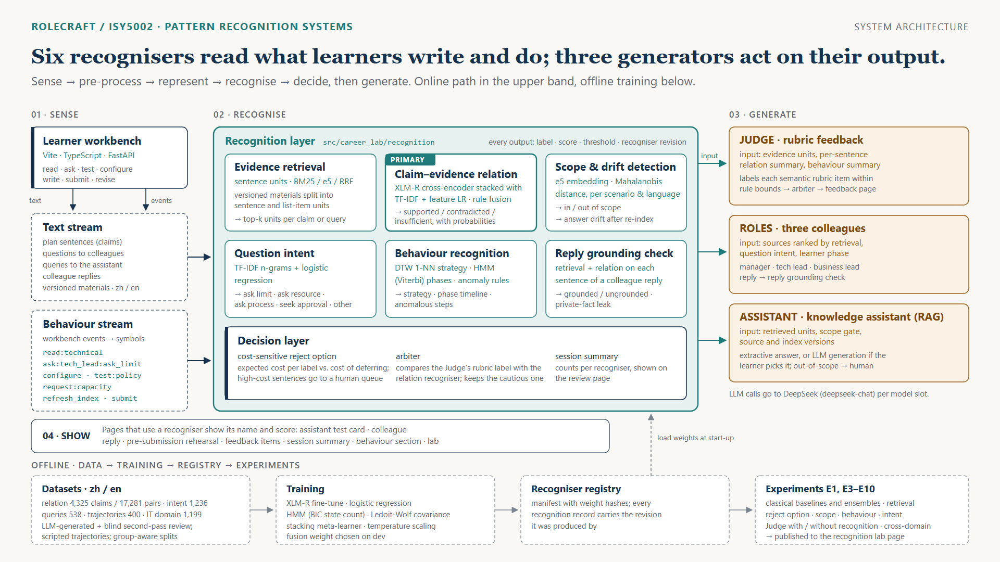

# RoleCraft

**在模拟职场练习中识别作品的证据依据与工作行为。**
ISY5002 Pattern Recognition Systems · Practice Module · Group 47 · [English](README.md)

学员扮演 AI 产品经理做一次试点决策：读版本化材料、向三位同事提问、测试一个检索增强的知识助手、配置试点、提交书面方案。RoleCraft 从这些工作里感知两条流——学员写的和读的**文本**，以及学员做的**动作序列**——并识别：

- 方案里每一句断言被材料**支持、矛盾，还是缺乏证据**（主识别任务）；
- 一句断言或一个问题对应哪些**证据单元**；
- 问知识助手的问题在不在**知识范围内**，重建索引后答案有没有**漂移**；
- 学员向同事提问的**意图**；
- 从动作序列识别学员的**策略、阶段和异常步骤**；
- 同事回复的每一句是否有**依据**（在该同事能看到的材料里）。

三个生成器基于这些结果工作：评分 Judge 先读逐句关系摘要再给评分项打标签；扮演的同事拿到按相关度排好的材料，以及识别出的学员意图和当前阶段；知识助手只从检索到的、范围内的单元作答。凡是用到识别结果的页面，都显示识别器名字和分数：助手测试卡、同事回复、交付前预演、反馈各项、会话汇总、行为模式、识别实验室。



## 识别器

| 识别器 | 输入 | 方法 | 输出 | 谁用 |
|---|---|---|---|---|
| **断言—证据关系判定**（主任务） | 方案句 × top-k 证据单元 | XLM-RoBERTa 交叉编码器（微调、温度缩放），与 TF-IDF + 特征逻辑回归堆叠；与数值限额规则晚期融合 | 支持 / 矛盾 / 证据不足、概率、证据 id | 评审输入、交付前预演、回复核查、仲裁 |
| **证据检索** | 断言或问题 × 材料 | 句子 / 列表项单元；BM25、multilingual-e5-small、RRF 融合 | 排好序的单元与分数 | 关系判定、知识助手、同事选源 |
| **范围与漂移检测** | 助手查询；不同索引版本下的答案 | e5 向量，按场景、语言、范围设置各拟合一个 Ledoit-Wolf 协方差的马氏距离；余弦漂移对照 2σ 区间 | 域内 / 域外；漂移异常 | 助手关卡、测试卡、评审输入 |
| **提问意图识别** | 学员问同事的问题 | 字符 2–4 gram TF-IDF + 逻辑回归 | 5 类意图 | 同事 prompt、行为符号 |
| **行为识别** | 工作台事件 → 26 个符号的序列 | 对 40 条参考轨迹做 DTW 1-NN；5 状态离散 HMM（BIC 选状态数、Viterbi 解码）；异常规则 | 最近策略、阶段时间线、异常、对齐 | 复盘页、同事 prompt、评审输入 |
| **同事回复依据核查** | 同事回复的每一句 | 检索 + 关系判定，对照该同事可见的材料和私有事实 | 每句有依据 / 无依据 / 泄露 | 回复气泡 |
| **决策层** | 关系概率；评审标签 | 带拒识选项的贝叶斯最小期望代价决策（显式代价矩阵）；保守仲裁 | 判定或送人工；仲裁后的标签 | 反馈页、复核队列 |

代码在 [`src/career_lab/recognition/`](src/career_lab/recognition/)。每个输出存成一条 `RecognitionRecord`（识别器 id 与权重修订号、标签、分数、阈值、引用），挂在它影响的对象上；`GET /sessions/{id}/recognition` 按会话返回。

## 识别器怎么驱动生成器

- **评审（评分反馈）**：评审给 14 个评分项任何一项打标签之前，识别层先把材料切成最多 80 个证据单元，把方案每一句对它的 top-5 单元做关系判定，按期望代价逐句决定判定还是送人工，再加上最近的范围检测结果和行为摘要。这份摘要放进每一个证据包；评审的指令要求先读识别结果，并在解释开头标 `[识别一致]`、`[识别缺失]` 或 `[与识别不一致：原因]`。在「依据」这一项上，仲裁在规则界内取评审与识别器中更保守的标签。
- **同事**：材料按与问题的检索相关度排序，prompt 里带 `learner_state`（识别出的意图和当前阶段）。回复之后，依据核查逐句标注。
- **知识助手**：每个查询先过范围检测，域外的在组织答案之前就转人工。稠密检索选出单元；回答是抽取式的，学员配置了生成模式时由 LLM 只基于这些单元生成。

## 结果

留出测试集，中文 / 英文；最后一行是 28 对实时会话。完整结果见 [`experiments/recognition/results/`](experiments/recognition/results/) 和识别实验室页（`#/lab`）。

| 任务 | 指标 | 结果 |
|---|---|---|
| 断言—证据关系 | 断言级 macro-F1 | 产品里的判定链（堆叠集成 + 数值限额规则）**0.698 / 0.635**；堆叠集成单独 0.713 / 0.633；XLM-R 单独 0.656 / 0.608；最好的经典模型（TF-IDF + 特征 LR）0.646 / 0.572 |
| 决策层 | 误扣分率 | 20% 的断言送人工时 4.2% → 0.7%（产品里的判定链） |
| 范围检测 | AUROC | 马氏距离 0.977 / 0.953（K-Means 0.907 / 0.832，单类 SVM 0.815 / 0.823，孤立森林 0.756 / 0.701） |
| 范围检测，新领域 | AUROC | 用 IT 知识库重新拟合 0.986 / 0.949 |
| 检索，改写问题 | Recall@5 | e5 0.82 / 0.79，RRF 0.65 / 0.57，BM25 0.49 / 0.36 |
| 提问意图 | 准确率 | 0.946 / 0.824（关键词规则 0.550 / 0.496） |
| 行为，步骤扰动 50% | 策略准确率 | DTW 1-NN 0.71，n-gram 随机森林 0.55 |
| 行为异常 | AUROC | HMM 对数似然 0.90，DTW 距离 0.88 |
| 评审有 / 无识别摘要 | 给出标签的项 | 42.6% / 38.9%；每项引用 1.12 / 1.05 |

### 公开数据上的评测

各识别器在带人工标注的公开数据上重新评测；关系判定还换了句对分类器：多语言 NLI 交叉编码器（mDeBERTa-v3，在 XNLI 和多语言 NLI 上预训练），在 `relation-v3` 加 ContractNLI、VitaminC、CFEVER 的 train 上微调。这个分类器是离线评测，产品里的判定链是上表第一行。方法、数据和完整表格见 [`docs/data/public-sources-v1.md`](docs/data/public-sources-v1.md) 第 8–10 节。

| 任务 | 测试数据 | 指标 | 结果 |
|---|---|---|---|
| 断言—证据关系，NLI 交叉编码器 | `relation-v3`（中 / 英） | 断言级 macro-F1 | **0.903**（0.894 / 0.908） |
| 断言—证据关系，NLI 交叉编码器 | ContractNLI / VitaminC / CFEVER（人写的断言） | 断言级 macro-F1 | 0.806 / 0.792 / 0.641 |
| 同事回复依据核查，NLI 交叉编码器，检索到的三个单元合成一段来读 | 基于真实材料的同事口吻回复（中 / 英） | 逐句三分类 macro-F1；泄露 F1 | 0.928；0.94 |
| 范围检测，产品方法按数据集重新拟合 | MASSIVE 中 / 英 | AUROC | 0.961 / 0.940 |
| 证据检索，e5 稠密 | PrivacyQA（众包提问，专家标注相关句） | Recall@5 / MRR | 0.770 / 0.562 |

## 数据

都在 `data/releases/<name>/`，每个目录有 `manifest.json`、`data_card.md` 和 `SHA256SUMS`。项目自建的数据全部中英双语：

| 数据 | 内容 | 规模 |
|---|---|---|
| `relation-v3` | 学员口吻的断言，每句配 1 个金标单元和 3 个难负例；九种现象（直述、否定、改写、无依据推断、数值比较、数字格式、槽位错配、把申请当批准、旧版本） | 4,325 断言，17,281 句对 |
| `intent-v1` | 五类意图 × 四种文风 | 1,236 个问题 |
| `assistant-queries-v1` | 域内直述 / 改写，近域外 / 远域外 | 538 个查询 |
| `paraphrases-v1` | 拟合范围检测用的域内改写 | 124 |
| `trajectories-v1` | 八种脚本策略对真实后端跑出的会话 | 400 条序列 |
| `it-ticket-v1` | 第二领域（IT 工单助手），做跨领域测试 | 1,199 断言、624 查询 |

断言和问题由 DeepSeek 生成，只保留看不到标签的第二遍复核一致的条目（关系 93.7%、意图 91.0%）；助手查询要求来源单元能被检索到。关系断言按语言和来源材料分组划分，同一事实的改写不会跨分区。

公开数据转成同样的记录格式：一类是真实文本加原数据集自带的人工标注，另一类是合成数据，但证据都取自真实的公开材料。

| 数据 | 来源 | 用于 | 规模 |
|---|---|---|---|
| `public-real-v1` | ContractNLI、VitaminC、CFEVER | 断言—证据关系 | 50,515 条断言 |
| `public-materials-v1` | GitHub site-policy、Kubernetes KEP、Public Jira Dataset、TheAgentCompany、tau-bench | 证据单元、签核清单、轨迹 | 13,319 个单元 |
| `public-synth-v1` | 对着真实证据单元写的断言 | 断言—证据关系 | 3,839 条断言 |
| `public-reply-v1` | RAGTruth | 回复依据核查 | 17,790 条回答、131,160 句 |
| `public-reply-synth-v1` | 基于真实材料的同事回复，含泄露 | 回复依据核查 | 603 条回复 |
| `public-scope-v1` | CLINC150、MASSIVE 1.1（中、英） | 范围检测 | 23,700 + 33,042 个查询 |
| `public-retrieval-v1` | PrivacyQA | 证据检索 | 1,750 个问题、35 份政策 |
| `public-queries-synth-v1` | 基于真实材料的知识库问题 | 检索、范围检测 | 2,658 个查询 |
| `public-sequence-v1` | tau-bench 运行记录、Jira 变更记录 | 行为识别 | 1,980 + 400 条序列 |
| `public-intent-synth-v1` | 基于真实材料的学员提问 | 提问意图 | 1,354 |

来源、固定版本和许可见 [`docs/data/public-sources-v1.md`](docs/data/public-sources-v1.md)；每个数据和权重目录是什么、放在哪，见 [`docs/data/DATA_INVENTORY.md`](docs/data/DATA_INVENTORY.md)。

## 场景

`pm_pilot`（企业内部知识助手试点，另有 `urgent` 和 `capacity15` 两个变体）和 `it_ticket_pilot`（IT 工单助手），各有中英文。学员会遇到 24 小时的索引延迟、30 人的容量上限、3 个开发人日和中途的政策更新；只上线稳定知识的小范围试点和申请更多资源，只要有事实支撑都可以成立。

## 运行

需要 Python 3.12 与 [uv](https://docs.astral.sh/uv/)、Node.js 22.12+。

```sh
uv sync --locked --extra encoder --python 3.12   # 识别器用的 CPU 版 torch 和 transformers
cd apps/web && npm ci && cd ../..
```

### 录好的会话（不调用模型）

[`demo/`](demo/) 里有 8 局走完的练习（两个场景 × 两种语言 × 完整一局 / 交付前）。导入只写数据库行。

```powershell
$env:CAREER_LAB_SCENARIO_CATALOG = "demo/catalog.json"
$env:CAREER_LAB_CREDENTIAL_KEY_ID = "local-dev-v1"
$env:CAREER_LAB_CREDENTIAL_KEY = "<至少 32 字节的任意密钥>"
New-Item -ItemType Directory -Force runs/demo | Out-Null
uv run python -m scripts.recognition.demo_pack import --db runs/demo/rolecraft.db --pack demo/demo-pack-v1.json.gz --catalog demo/catalog.json
uv run career-lab serve --host 127.0.0.1 --port 18562 --database-url sqlite:///runs/demo/rolecraft.db
# 另开一个终端
cd apps/web; $env:ROLECRAFT_API_TARGET = "http://127.0.0.1:18562"; npm run build; npm run preview -- --port 18560
```

打开 `http://127.0.0.1:18560/`，点「有继续码？」，输入导入时打印的码。

逐页看什么：

1. **测试记录**：域内问题检索到对应的 FAQ 单元；「火星天气如何？」被马氏距离判为域外、转人工；政策问题在重建索引前后各测一次，标出漂移（「数值变化 500 → 400」）。
2. **同事回复**：每条回复下有提问意图和几句有依据。
3. **交付前预演**（标着「交付前」的几局）：工作板点「交付」→ 勾作品版本 → 选「缩小范围推进」。上半是规则核实，下半是方案逐句标色（有依据 / 与材料矛盾 / 证据不足 / 送人工），附命中的材料原句。不要点「提交选中的版本」。
4. **反馈**：语义评分项的解释以 `[识别一致]`、`[与识别不一致：…]` 或 `[识别缺失]` 开头；「依据」一项带仲裁记录。
5. **修订**：完整一局里有第二次交付，可以对照两版的反馈和逐句标签。
6. **复盘**：会话汇总一行列出每个识别器的记录数；「你的行为模式」给出最近策略、HMM 阶段时间线、异常和与最近参考路径的对齐。
7. **识别实验室**（`#/lab`）：选方案里任一句，看检索 → 关系概率 → 代价决策 → 给评审的识别摘要 → 仲裁的全链，下面是离线实验图。

重新录制演示见 [`demo/README.md`](demo/README.md)。

### 完整系统

另外需要识别器权重（`runs/local/recognizers/`：XLM-R 关系模型、e5、范围拟合、意图模型、行为参考、堆叠集成）和放在 `ds.txt` 的 DeepSeek key。

```powershell
$env:CAREER_LAB_RECOGNIZERS = "runs/local/recognizers"
$env:CAREER_LAB_RELATION_ENCODER = "runs/local/recognizers/c1-xlmr-cpu"
foreach ($s in 'JUDGE','ROLES','ASSISTANT') {
  Set-Item "Env:CAREER_LAB_${s}_PROVIDER" 'deepseek'
  Set-Item "Env:CAREER_LAB_${s}_KEY_FILE" "$PWD\ds.txt"
}
uv run career-lab serve --host 127.0.0.1 --port 18562 --database-url sqlite:///runs/local/rolecraft.db
uv run career-lab worker --database-url sqlite:///runs/local/rolecraft.db   # 起 2–3 个
```

上一段的场景目录和凭据变量照样设，前端同样启动。

### 复现数据、模型和实验

命令同[英文版](README.md#reproducing-data-models-and-experiments)，包括公开数据上的 E11–E15。实际用的生成参数记在每个数据目录的 `manifest.json` 里；行为实验另需 `hmmlearn==0.3.3`。公开数据的下载、转换、合成命令和各脚本要用的环境，见 [`docs/data/public-sources-v1.md`](docs/data/public-sources-v1.md) 第 4 节和第 7.3 节。

## 目录

```text
src/career_lab/
  recognition/     识别器、登记、识别记录（本项目的核心）
  evidence/        给评审的证据包
  rubrics/         评分规则、评审、分数区间
  runtime/         同事角色、模型槽、上下文装配
  assistant/       知识助手（检索、关卡、生成）
  scenarios/       场景引擎与场景包
  api/ jobs/ storage/ mcp/ delegations/   服务、任务队列、事件存储、Agent 接入
apps/web/          学员工作台与识别实验室（Vite + TypeScript）
experiments/recognition/   E1、E3–E15 的脚本与结果
scripts/recognition/       数据生成、策略运行器、演示录制与导入
scripts/public/            公开数据下载、转换与基于真实材料的合成
scenarios/         已安装的场景包（pm_pilot、it_ticket_pilot）
demo/              录好的会话与目录
docs/              设计、计划、图
```

## 成员

FENG Tangyu · LIU Kairui · YING Hao · ZHANG Junming
