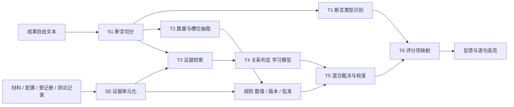

# RoleCraft 设计调整 v3：以模式识别为核心的评价引擎

版本：3.1　日期：2026-10-16　文档类型：设计调整（问题重定义、架构、数据、实验、排期）

修订记录：3.0 为同日初稿；3.1 同日加入第 12 节"模式识别加强包"（七个模块、数据类型总表、文献），并相应更新第 4、5.6、6、7、8、9 节；3.2 同日晚加入第 13 节"课件方法对照"和下面的 0A 节。**0A 节推翻了本文前面若干前提，阅读顺序：先 0A，再 1–13。**

## 0A. 与 GitHub main 的差异与范围重定（2026-10-16 晚）【已核实】

本文 1–13 节写作时依据的是本地目录 `5002GPJ`，它停在 10-06 的提交 `fdb4b87`。当晚 `git fetch` 后核实：`origin/main` 已到 `319c2a9`（10-15），本地落后 **685 个提交**，57 个 PR 已合并，提交者为 Jeffrey（628）与 Kairui（57）。远端已不是本文第 1 节描述的那个项目。

### 0A.1 远端已有的（本文曾当作"待做"的）

| 本文的设计 | origin/main 上的对应实现 | 位置 |
|---|---|---|
| S1 断言切分（按标点切句、少于 4 字不判） | 已有，规则名 `r2-support-units-v1`，每包最多 24 句，与产品推理同一函数 | `src/career_lab/models/v3/units.py` |
| T4 逐对交叉编码 + 聚合为断言标签 | 已有接收端：编码器回传 v3，`pack` / `pair` / `pair_aggregate` 三种结构，`pair_aggregate` 的聚合规则与本文 2.2 节几乎相同（矛盾优先、支持须胜过无关、阈值 ≥ 0.5）；期望底座 XLM-R base，512 token，CPU float32，torch 2.8.0 / transformers 4.57.1 | `docs/data/return-v3/encoder-return.md`、`models/v3/huggingface.py` |
| T5 版本有效性规则 | 已有：`valid_from_seq` / `valid_until_seq` 判定合法证据，gold 不得引用失效证据 | `models/v3/temporal.py` |
| T5 概率融合与阈值网格 | 已有：`joint-first-dev-v1` 选点规则，alpha 0/0.25/0.5/0.75/1 × 证据阈值 0.25/0.5/0.75，只在 dev 选，joint 为第一指标 | `docs/data/return-v3/fusion-selection.md` |
| T6 评分项映射、规则界 | 已有且更完整：rubric v2 final 共 **14 项**（比本文多 `R2.failure_analysis`、`R6.alternatives`），`rules_v2` 给每项规则下界/上界，模型建议只能在规则界内 | `rubrics/v4/rules_v2.py`、`rubrics/v4/definitions/` |
| claims/check 逐句反馈 | 已有：反馈页按句显示 `model_advice`，带引用回跳、覆盖率三类计数、"模型建议（不计分）"标识；另有交付前预演卡 | `apps/web/src/features/feedback-native/`、W08 文档 |
| Streamlit 界面 | 不需要：React/TypeScript 工作台 v4 已有 401 个文件、94 项 Vitest | `apps/web/` |
| 证据预算整包清空的缺陷 | 已改为逐句推理，不再整包送模型 | 同上 |
| 角色私有事实泄露 | 已有角色权限视图与私有端口边界测试 | `tests/expansion_v3/w04/test_private_port_boundary.py` |
| 新冻结协议 | 已有：注册身份只锁 `models/**` 与依赖版本，不锁全部源码 | W08 "注册与冻结身份" |
| 数据 v3 的断言级记录 | 已有导出：`datasets.v3 export --live --relation-units` 把每份提交的每一句导出为关系记录（claim 为该句，候选为同包材料），**标签为 pending，等负责方标注** | `docs/data/expansion-v3-w07.md` |
| 数据分区与封存 test | 已有格式：`rolecraft-dataset-split-sealed-v1`，test 一次性打开需项目负责人确认 | `return-v3/dataset-split-sealed-v1.md`、`test-opening-v1.md` |
| 模型标注两遍复核 | 已有机制：`datasets/v3/labeling.py`，"双遍与证据集合" | W07 |
| 学员自带 Agent、参考 Agent、工程师路径、场景编译器、分支 | 全部已有最小实现（v2.2 的 P1 在远端已做完） | `mcp/`、`reference_agent/`、`engineer/`、`scenario_compiler/` |

远端**没有**的：T1 断言类型分类器、T2/M6 槽位抽取（远端的事实来自装配器的结构化数据，不从文本抽）、M1 代价敏感拒识（有弃权和待核验，没有代价矩阵）、M2 分布外检测、M3 行为轨迹识别、M4 度量学习检索、M5 原型解释、M7 学习曲线、T7 聚类，以及**任何一个训练过的模型**。

### 0A.2 分工的事实

远端文档把工作分成"我方"（产品与接收端，Jeffrey）和"负责方"（数据、标注、划分、训练、融合、SFT/GRPO、评价项五分类、实验结论）。`docs/HANDOVER.md`："负责方真实训练模型尚未交回"；W08："负责方真实数据、checkpoint、训练执行、分语言质量和 E1/E2 实验结论仍待交付"；`training_ready` 为 `false`。远端还列了三项等负责方答复的事：评价项五分类走 Judge 还是独立 head；是否做 Judge SFT；是否做 GRPO。

本仓库的初始提交和实验 v2 由 YH 完成，远端的回传格式包"写给负责数据、标注与训练的同学"。所以本文的作者方就是负责方，本文的正确定位是**负责方的工作计划**，不是整个项目的重设计。

### 0A.3 范围重定

据此，本文各节的效力调整如下：

| 节 | 处置 |
|---|---|
| 1 为什么要调整 | 对"识别问题选错了"（K4）的论证仍成立；K1–K3、K5–K6 描述的是旧快照，远端已改 |
| 2.2 S0 证据单元化 | **仍需做，且是远端在等的决定**：远端候选现在是整篇材料，XLM-R 实测引用整篇时每句都超 512 而弃权；HANDOVER 后续清单"R2.support 候选长度"写明"先定口径再派"。负责方答复：按句/段分块，口径按本文 S0 |
| 2.2 S1、T4 聚合、T5 版本规则、T6、5.3 接口、5.4 冻结、5.5 修复、5.6 界面 | 作废，用远端实现 |
| 2.2 T1、T2 | 保留为负责方的实验；T1 对应远端待答复的"五分类走独立 head"，答复为：走独立 head，格式按远端补发 |
| 2.2 T3 检索、M4 | 远端只评给定证据的设置，"含检索的评测本次不发布"；作为负责方自己的实验做，不进产品 |
| 3 数据 v3 | 保留，但格式改为远端的 `split-sealed-v1`，记录须含 `unit_hash` 以对回产品句；**必须中英双语**（远端已定"中英文评测为必需覆盖"，英文演示确定） |
| 4 实验 | 保留；R1、R2 的结果按远端 `predictions-v3` 格式交回，由远端 `verify-return` 复核 |
| 5.1 代码结构 | 作废；负责方代码放自己的训练工程，只交回传包 |
| 6 演示脚本 | 由远端工作台承担；负责方提供"识别实验室"的内容（图表、数字） |
| 8 范围、9 时间线 | 重写，见 0A.4 |
| 12 加强包 | 保留为负责方实验。要进产品界面的（M1 拒识状态、M2 助手转人工、M3 行为模式页）需要远端新增接收与显示，先与 Jeffrey 商定，否则只进报告 |
| 13 课件对照 | 保留 |

### 0A.4 负责方本期交付清单（替代第 8、9 节）

按远端已定义的接口，负责方要交的东西是明确的：

| 编号 | 交付 | 远端接口 | 状态 |
|---|---|---|---|
| D1 | 数据包 `split-sealed-v1`：中英关系记录（含作品单句 `unit_hash`）、train/dev/封存 test、lineage、data card、标签等级 G0/G2v | `dataset-split-sealed-v1.md`、`validate-handoff` | 未开始；来源：远端 `export --live --relation-units` + 本文 3.3 节生成矩阵 |
| D2 | 线性回传 `rolecraft-linear-return-v1`（TF-IDF + LR，带证据头） | `linear-return.md`、`export_sklearn_linear.py` | 未开始 |
| D3 | 编码器回传 v3（`pair_aggregate`，safetensors，512 token） | `encoder-return.md`、`export_hf_return.py` | 未开始；底座待定，见 0A.5 |
| D4 | 融合选择记录 `joint-first-dev-v1` | `fusion-selection.md` | 未开始 |
| D5 | dev 预测行 v3；冻结后 test 预测行，一次性打开 | `predictions-v3.md`、`test-opening-v1.md` | 未开始 |
| D6 | 三项答复：五分类走独立 head；SFT 不做（无 GPU，报告写未执行）；GRPO 不做 | HANDOVER 后续清单 | 本文即答复，待负责方确认后转告远端 |
| D7 | 候选长度口径答复：按句/段分块（本文 S0） | HANDOVER "R2.support 候选长度" | 同上 |
| D8 | 实验报告：R1–R12 中能在负责方环境独立完成的（R1、R2、R3、R4、R6、R7、R8、R9、R10、R11、R12），分语言报告 | 报告与 slides | 未开始 |
| D9 | 加强包中进产品的部分：与远端商定后，M2 以 ASSISTANT 槽或独立接口接入；M3 以新页面接入 | 需远端新工作 | 待商定 |

时间线：10-17 至 10-19 拿到远端导出并生成 D1 试点 200 条、跑通 D2 与 `verify-return`；10-20 至 10-24 全量 D1、D3 训练、D4；10-25 冻结、D5；10-26 至 10-28 D8；10-29 至 10-31 报告与视频。砍法顺序沿第 9 节。

### 0A.5 待决定

| 编号 | 事项 | 建议 |
|---|---|---|
| X1 | 本地目录处置 | 不要在 `5002GPJ` 上合并（它有 2 个远端没有的本地提交和未跟踪的 `docs/superpowers/`）。另 `git clone` 一份 main 到新目录，把本文复制过去作为负责方计划，`docs/superpowers/` 其余旧文档不再带入 |
| X2 | 编码器底座 | 远端期望 XLM-R base，且要求中英双语。本文附录 A 的 CPU 实测只有中文模型；XLM-R base 278M 全量微调按比例推算一轮约 1.5 小时以上，冻结底部 8 层可减半。可选：XLM-R 冻结底层；或 `microsoft/Multilingual-MiniLM-L12-H384`（更小，需确认远端加载器接受）。先跑一次 XLM-R 冻结底层的吞吐实测再定 |
| X3 | 五分类（criterion）head | 答复"独立 head"后远端要补接收工作；若时间不够，五分类只在报告中作为实验，不进产品 |
| X4 | M2、M3 进产品还是只进报告 | 先问 Jeffrey 的余量；默认只进报告加识别实验室图表 |

适用期：今天到 2026-10-31 提交。本文与[扩建规范 v2.2](2026-10-06-rolecraft-expansion-spec.md)冲突时以本文为准。v2.2 中本文没有提到的契约和不变量继续有效，尤其是第 15 节的不变量。v2.2 配套的执行计划和数据计划里，凡是属于本文第 8 节"移出本期"的工作包，不再执行。

陈述标记沿用 v2.2：**【已核实】**是 2026-10-16 实际运行或读源码确认的；**【设计】**是本文提出、尚未实现的；**【估计】**是没有实测依据的判断。

## 0. 一句话

把"评价学员方案"本身做成模式识别系统。系统从学员写的自由文本里识别出一条条断言，判断每条断言的类型和其中的数量，找到提交时有效的证据，判定支持、矛盾还是证据不足，再汇总成评分项。学习模型负责语义识别，规则负责算术、版本和批准状态。两者混合是必需的，不是装饰。

## 1. 为什么要调整

### 1.1 今天核实的事实【已核实】

| 编号 | 事实 | 核实方法 |
|---|---|---|
| K1 | `src`、`tests`、`scenarios` 自 `1ebd3a7` 以来没有改动；80 项测试通过、1 项跳过（未配 PostgreSQL）；扩建计划的认领表为空，没有工作包开始 | `pytest -q`；`git status`；读 [扩建进度](../../reports/expansion-progress.md) |
| K2 | 学习模型只能经旁路接口 `/relation-checks` 调用，正式反馈全部来自 `rules-v2`。按演示流程走一遍，12 个评分项中 8 个为 INSUFFICIENT，覆盖率 0.2 | 在临时 SQLite 库上逐个调用 API |
| K3 | 旁路接口对三句断言全部返回 SUPPORTED。其中"50人试点符合当前容量要求"（上限 30）和"当前开发资源足够完成实时同步"（3 人日对 5 人日）判错，而且每句都引用了全部 7 条候选证据 | 同上 |
| K4 | v2 数据的标签由整数比较决定。例如断言"条件为(参与人数不大于生效容量)。该条件成立。"，配证据"生效容量：7。""参与人数：6。"字符 n-gram 无法表示数值大小，所以线性模型的 test Macro-F1 只有 0.43、MLP 只有 0.36（三分类随机水平约 0.33）。混合模型能到 0.65，增益来自能解析数字的规则 | 读 `data/releases/controlled-v2/splits/train.jsonl` 与 [v2 结果](../../reports/controlled-v2-results.md) |
| K5 | 证据单位是整篇文档。会话一长，证据包超过 16,000 字节预算，就被整包清空（即 v2.2 的 F3） | 读 [assembler.py](../../../src/career_lab/evidence/assembler.py) |
| K6 | 知识助手把整篇文档当答案；"火星天气如何？"和"帮我查报修单处理到哪一步"都返回整篇 FAQ，`fallback=false` | 临时库上实测 |
| K7 | 本机 22 线程、31.5 GB 内存、无 GPU。全局 Python 3.13 装有 torch 2.10（CPU 版）和 transformers，项目虚拟环境（3.12）没有。可以从 hf-mirror.com 下载模型；直连原站下载 400 MB 文件中途断开过 | 实测 |
| K8 | 现成的中文 NLI 模型 Erlangshen-Roberta-110M-NLI 在 10 条手写的场景句对上零样本判对 6 条。语义类（政策 400 对 500、"总能立即反映最新政策"、会议室预约）基本正确；两条数字比较全错；还有一条无关证据被判成矛盾 | 下载后实测，见附录 A |
| K9 | CPU 训练吞吐（序列长 64，batch 16）：rbt3（38.5M）每秒 7.2 条，1 万个句对跑一轮约 23 分钟。Erlangshen-110M 全量微调每秒 1.8 条（一轮约 93 分钟），冻结底部 8 层后每秒 3.6 条（一轮约 46 分钟）。批量推理每对 25 ms（rbt3）到 130 ms（110M） | 实测，见附录 A |

### 1.2 结论

问题不在模型不够大，在于识别问题本身选错了。

v2 让学习模型做数值比较。这件事规则一行就能做对，文本分类器从原理上就做不到。真正需要识别的东西，也就是学员自由文本里的说法与当时的证据是否一致，反而被留给了一句"该项需要进一步语义核验"。学习模型最后只能挂在旁路上，演示时看不见；就算拿出来，在真实输入上也会判错。

所以调整四件事：

1. 识别对象从"模板句里的数值关系"改为"学员方案里的自然语言断言"。
2. 学习模型和规则按能力分工。模型负责语义：同义改写、否定、隐含意思、口语说法，以及某条证据跟这句话是否相关。规则负责算术、版本是否有效、批准是否已生效。
3. 识别结果进入主流程：学员写方案时逐句标注，提交后由识别结果决定多数评分项，不再停在旁路。
4. 证据单位从整篇文档改为句子级，引用哪几条证据由模型给出，解决 v2 中 joint correctness 为 0 的问题。

K8 这个小实验同时说明了两件事：语义类判断已经有一个能用的起点；数字比较必须交给规则。这就是混合设计的直接依据。

## 2. 识别任务定义【设计】

### 2.1 输入与输出

**输入**：一次提交，包括成果的各个字段，主要是 `rationale` 等自由文本；以及提交时点 `as_of_seq` 学员可见的全部证据，即材料（含已被取代的旧版本）、试点配置、批准登记册和知识助手测试记录。

**输出**分两层：

- 每条断言：类型、其中的数量、关系标签（SUPPORTED / CONTRADICTED / INSUFFICIENT）、引用的证据单元、校准后的置信度，以及由哪条路径判定。
- 每个评分项：MET / PARTIAL / NOT_MET / NOT_APPLICABLE，或"待核验"，并附上依据的断言和证据。

### 2.2 流水线



S 开头的是确定性步骤，T 开头的是识别任务。下面逐一说明。

**S0 证据单元化（确定性）。** 文档按标题、条目和句号切成单元，保留字符偏移，用于界面高亮。单元 ID 写作 `{material_id}@v{version}#{n}`。配置、登记册和测试记录由程序转写成描述句，例如：

- "提交时配置：试点人数20人，知识范围仅稳定FAQ，更新策略每日，人工fallback开启。"
- "批准登记册：没有扩容批准，没有资源批准。"
- "第4步测试'住宿报销上限是多少？'，助手引用政策v1回答500元；此时源文档已是v2。"

每个单元带 `valid_from_seq`、`superseded_at_seq`（被新版本取代的时点）和结构化槽位（如 `{"capacity": 30}`）。槽位只由程序从场景 YAML 写入，不从文本里猜。pm_pilot 大约会有 40 个文档单元，再加若干程序单元【估计】。由于每条断言只检索 top-5 单元，整包超预算（K5）的问题随之消失。

**S1 断言切分（确定性）。** 按句号、分号、换行和条目符号切分，丢掉少于 4 个字的片段，保留来源字段名和偏移。

**T1 断言类型识别（监督学习，文本分类）。** 共 11 类：人数与用户组、知识范围、更新与同步、人工兜底、资源与期限、批准状态、测试结果、成功指标、运行安排（负责人、观察窗口、退出条件）、变化影响、假设与不确定；另设"其他"。T1 的作用有两个：一是决定一条断言送去支撑哪些评分项（见 T6）；二是决定要不要核验真假。比如"成功指标"类一般不核验真假，只核验是否可观察。模型以 TF-IDF 加逻辑回归为主，时间允许再加 rbt3 微调做对照。

**T2 数量与槽位抽取（混合：规则抽取加学习分类）。**

- 规则部分：抽出所有数量表达，包括阿拉伯数字、汉字数字（"五十人""三个人日"）和约数（"二十来人"），归一为数值和单位。
- 学习部分：对每个数量，取上下文窗口（前后各 12 个字加单位），判断它属于哪个槽位：participants、capacity、dev_days、work_days、deadline_day、delay_hours、amount_yuan、percent、other；同时识别比较方向，即不超过、足够、超出还是等于。用逻辑回归即可。

这一步之所以要学：同一个"30"可以是人数、容量或天数；"开发资源"可以说成"人力""工时""开发同学的时间"。规则只能覆盖写法固定的那部分，所以纯规则版本作为对照基线。

**T3 证据检索（排序）。** 候选是 S0 的全部可见单元，包括旧版本。比较三种方法：现有的中文二元组 BM25、`BAAI/bge-small-zh-v1.5`（24M，MIT 许可）稠密检索、两者的 RRF 融合。取 top-5 进入 T4。指标是以金标证据单元为准的 Recall@1/3/5 和 MRR。

**T4 关系判定（监督学习，主模型，深度学习）。** 采用逐对交叉编码：输入 `[CLS] 断言 [SEP] 证据单元 [SEP]`，输出这个单元对断言是支持、矛盾还是无关。再聚合成断言级标签：

- 当前有效的单元里有高置信的矛盾，判 CONTRADICTED；
- 否则有高置信的支持，判 SUPPORTED；
- 否则判 INSUFFICIENT。

引用集合就是超过阈值的那些单元。这样引用哪些证据由模型决定，不再是"全部引用"。

候选模型：

| 代号 | 模型 | 说明 |
|---|---|---|
| B0 | 多数类 | 下限 |
| B1 | TF-IDF + 逻辑回归 | 沿用 `models/linear.py`，输入改为逐对 |
| B2 | 字符 MLP | 现有实现，如实称为浅层神经网络 |
| D0 | Erlangshen-Roberta-110M-NLI 零样本 | Apache-2.0，已在中文 NLI 数据上训练过 |
| D1 | D0 在 v3 训练集上微调，冻结底部 8 层 | 主候选 |
| D2 | hfl/rbt3 全量微调 | 快速迭代；同时回答"NLI 预训练是否有用" |
| L0 | DeepSeek 零样本 | 参照组：比较准确率、延迟和单次成本，不进入部署候选 |

提案承诺的 xlm-roberta-base 不作主候选。它有 278M 参数，按 K9 推算，在 CPU 上跑一轮要超过 1.5 小时。只有第 9 节时间线有余量时才做一次对照，报告里说明原因。

**T5 混合裁决与校准（混合 / 集成）。**

- **数值路径（规则）**：T2 抽到了槽位和数值，且场景账本里有这个槽位时，用提交时点有效的值做比较（考虑批准事件，例如扩容批准后上限变为 60），并引用定义该槽位的单元。
- **版本检查（规则）**：只有已被取代的旧版本单元支持时，不判 SUPPORTED。若当前版本的单元与之矛盾，判 CONTRADICTED；否则判 INSUFFICIENT，原因写"仅旧版本支持"。这对应提案里"旧文档的支持不能证明当前有效"。T4 只负责语义：v1 单元"上限500元"对断言"上限是500元"本来就是支持，版本由规则来管。
- **批准检查（规则）**：断言把"已申请"说成"已批准"时，以登记册为准。
- **概率融合（集成）**：B1 与 D1 的概率按 α ∈ {0, 0.25, 0.5, 0.75, 1} 在 dev 上选权重。
- **级联**：数值路径能判就用规则，否则用融合模型。另做一组堆叠对照：以 B1 概率、D1 概率和"规则是否适用"为特征训练逻辑回归，在 dev 上交叉验证。
- **校准与弃权**：在 dev 上做温度缩放，选一个阈值，使已判定部分的精确率不低于 0.9；低于阈值的进"待核验"。报告覆盖率—错误率曲线。

**T6 评分项映射（确定性，透明）。** 每个评分项由哪些识别信号决定，写成一张表（2.3 节），放在代码里，同时在反馈中展示。

**T7 错误说法聚类（无监督，P1）。** 用 bge-small-zh 给测试集提交中被判 CONTRADICTED 或 INSUFFICIENT 的断言取向量，做 KMeans（k 按轮廓系数选），每簇给出代表句。它的用途是让教师看到"学员常见的错误说法"，同时补上课程第一项要求里的无监督学习。

### 2.3 评分项映射

| 评分项 | 现在（rules-v2） | v3 的判定依据 |
|---|---|---|
| R1.target | 只检查字段是否为空 | T1 识别出的用户组断言和业务目标断言：两者都有为 MET，只有一个为 PARTIAL，都没有为 NOT_MET |
| R1.metrics | 只检查字段是否为空 | T1 的成功指标类断言，加上 T2 是否抽到数值目标和统计口径词（比率、数量、窗口）：都有为 MET，只有指标名为 PARTIAL |
| R2.support | 一律待核验 | 关键事实断言（类型为人数、资源、更新、批准、测试结果）的 T5 结果：全部 SUPPORTED 为 MET，有 CONTRADICTED 为 NOT_MET，其余为 PARTIAL |
| R2.unknowns | 一律待核验 | 涉及未批准资源或未测试收益的断言：被 T1 识别为"假设与不确定"或带限定语的为 MET；用确定语气陈述，且 T5 为 INSUFFICIENT 或 CONTRADICTED（如把申请当批准）的为 NOT_MET |
| R3.capacity / R3.resources | 规则 | 仍由规则判定；另把 T2 抽出的方案人数与配置人数比对，不一致时给 PARTIAL（对应 rubric 中"方案人数与配置不一致"） |
| R4.functional_tests | 规则：有测试即 PARTIAL | 规则检查测试记录；再看 T1 的测试结果类断言是否被测试记录支持（T5），据此区分 MET 和 PARTIAL |
| R4.staleness_test | 规则 | 不变 |
| R5.impact | 无事件为 N/A，有事件则待核验 | 有"变化影响"类断言，且 T5 对新政策值判为 SUPPORTED，或明确说明不受影响且配置不含政策域：MET；仍按旧值陈述：NOT_MET |
| R5.adjustment | 同上 | 变化影响断言加配置历史（规则）对比：方案和配置都调整了为 MET，只在文字中提到为 PARTIAL |
| R6.consistency | 一律待核验 | 把 T1、T2 抽出的人数、知识范围、更新策略、fallback 与提交配置逐项比对，有矛盾即 NOT_MET。本质上是以配置单元为证据的 T5 关系判定 |
| R6.operations | 规则检查字段齐全后待核验 | 字段齐全，并且 T1 的运行安排类断言包含可执行动作（暂停、转人工、通知）：MET |

每一项都保留"置信度不够就待核验"的出口。反馈中分别报告规则已定标、模型判定、待核验三类覆盖率（v2.2 不变量 7）。

## 3. 数据 v3【设计】

### 3.1 为什么要新数据

v2 的 1,152 条数据保留，照旧发布，但不能用来训练 v3：它没有自然语言变化，标签由数值决定，证据是固定格式的短句。v3 需要的是：同一事实的多种说法、真假两面、与版本时点相关的变化，以及足够多的不同场景，用来检验泛化。

### 3.2 场景账本

- **pm_pilot**（含两个变体，属于同一结构）：用于演示和同域测试。
- **新增 10 个微型场景**：只用于生成识别数据，不做成可玩场景。每个场景是一份 YAML 账本，包含 6 到 10 个事实槽位、一次版本变化、一种批准规则，以及 15 到 25 句材料文本。候选题材：客服退款问答机器人、发票识别报销录入、IT 工单自动分流、会议纪要助手、销售报价助手、新员工入职问答、采购比价助手、设备巡检报告摘要、内部培训题库助手、门店排班建议。招聘筛选这类涉及公平性的题材不选。
- 材料由 LLM 按账本起草，再由程序校验三点：材料里出现的每个数值都等于账本值；每个槽位至少有一个单元定义它；版本变化前后的值各自出现在对应版本里。
- **分区**：微型场景按场景整体划分，6 个训练、2 个开发、2 个测试。pm_pilot 内部再按"事实根"（同一事实的全部说法）做 60/20/20 划分，提供同域测试。

### 3.3 断言生成矩阵

对每个场景的每个槽位，按"目标标签 × 现象"生成学员口吻的句子，每格 2 到 3 句，四种文风（简洁、啰嗦、口语、条目式）轮换。

| 现象 | 例子（pm_pilot） | 标签 |
|---|---|---|
| 直述 | 试点上限是30人。 | SUPPORTED |
| 改写 | 没批扩容前最多只能让三十位同事参加。 | SUPPORTED |
| 否定 | 容量并不限制在30人以内。 | CONTRADICTED |
| 数值比较 | 安排50人参加试点没问题。 | CONTRADICTED |
| 数字写法 | 首期二十来人，在上限之内。 | SUPPORTED |
| 旧版本 | 住宿报销上限是每晚500元。（v2 已生效时） | CONTRADICTED |
| 申请当批准 | 我们已经拿到6人日资源。（实际只提交了申请） | CONTRADICTED |
| 无依据推断 | 上线后咨询量会下降一半。 | INSUFFICIENT |
| 槽位错配 | 实时同步需要3人日。（3 是现有资源，同步需要 5） | CONTRADICTED |

并非每个格子都成立，例如"申请当批准"只适用于有批准规则的槽位。生成前由程序枚举出合法的格子。每条断言配 1 个金标单元和 3 个难负例单元：同槽位的旧版本、数值相同但槽位不同、同话题但不相关的句子。

规模【估计】：11 个场景 × 约 8 个槽位 × 约 10 个合法格子 × 2.5 句，约 2,200 条断言、8,800 个句对。按 K9，rbt3 跑一轮约 20 分钟。

### 3.4 标签与复核

标签来自生成规格。生成时就已经规定了：这句话的关系标签、证据是哪个单元、含哪个槽位的什么数值、属于哪种断言类型。T1、T2、T4 的标签都由此得到，不需要另外标注。

风险在于 LLM 写出来的句子未必符合规格，所以要复核：

- 每条句子交给第二遍模型盲判：只给断言和候选单元，不给规格。判断与规格一致才保留；不一致的丢弃，或交第三遍裁决。
- 程序再检查两点：句子里的数值与规格一致；T2 的槽位跨度能在句子里定位到。
- 标签等级记为 G2v（生成规格加独立模型复核一致），不称为人工标签（v2.2 不变量 9）。报告给出复核一致率和丢弃率。
- 生成和复核尽量用不同厂家的模型：DeepSeek 负责生成；`openai.txt` 的密钥可用就用它复核，否则用 DeepSeek 换一套提示词复核，并在报告中写明同源的局限。L0 基线如果也用 DeepSeek，同样要注明它与生成器同源，结果可能偏高。
- 人工抽检仍是可选项（v2.2 的 U6），但建议做：两名成员各看 30 条 test 样本，约一小时，就能得到"模型标签与人工判断的一致率"。这是评审最可能追问的数字。

### 3.5 端到端评分项数据

为评测 T6 和整条流水线，在 pm_pilot 上生成约 150 份完整提交：

- 每份先抽一个"质量画像"，即 12 个评分项各自的目标标签；再由 LLM 写出对应的成果文本。同时用现有后端按画像实际执行一遍会话（配置、测试、申请），这样证据环境是真实运行出来的，不是手写的。
- 规则类评分项的金标由现有规则引擎算出；语义类评分项的金标由画像给出，并经第二遍模型复核。
- 按 50/100 分为 dev 和 test。T6 没有学习参数，dev 只用来确定置信阈值。

### 3.6 发布与防泄漏

- 发布目录为 `data/releases/recognition-v3/`，格式沿用 v2：manifest、splits（输入）、gold（单独存放）、lineage、audit_report、data_card。v2 目录不动。
- 断言级记录直接复用现有契约：`EvidencePackage`（task_type 为 relation，candidate_evidence 放证据单元，id 用单元 ID）和 `GoldAnnotation`（acceptable_evidence_sets 放金标单元集合）。这样现有的 `evals/runner.py` 和 grader 能直接评 T4、T5 的标签、证据分和 joint correctness。T1、T2 的标签以及现象、文风写在 lineage 侧文件里，用于切片分析。
- 同一事实根的全部改写放在同一分区。跨分区做字符 5-gram Jaccard ≥ 0.8 的近重复检查，命中的从 test 中剔除。test 的输入和金标不参与提示词调试、训练和选型。

## 4. 实验【设计】

| 编号 | 问题 | 对照组 | 主要指标 |
|---|---|---|---|
| R1 | 哪种模型最能识别断言与证据的关系 | B0、B1、B2、D0、D1、D2、L0 | 断言级 Macro-F1、逐类精确率与召回率、混淆矩阵；证据 F1；joint correctness |
| R2 | 混合是否比单一路径更可靠 | 仅规则（不适用即弃权）、仅 D1、级联、B1 与 D1 融合、级联加融合、堆叠；各组校准前后 | R1 的指标，加误扣分率、错误放行率、覆盖率—错误率曲线、ECE |
| R3 | 检索对端到端的影响 | BM25、bge-small-zh、RRF；金标证据输入与检索证据输入对比 | Recall@k、MRR；R2 最佳方案在两种输入下的差值 |
| R4 | 类型与槽位识别 | T1：LR（必做）、rbt3（可选）；T2：仅规则，或规则加 LR | T1 Macro-F1；T2 槽位准确率、数值精确匹配率 |
| R5 | 整条流水线能否提高评分项覆盖率而不乱扣分 | rules-v2（现状）与 v3 流水线 | 各评分项准确率、四类 Macro-F1、误扣分率、覆盖率（目标是从 0.2 明显提高，不预设具体数字） |
| R6 | 稳健性与泛化 | 按现象切片；同域（pm_pilot）与未见场景；扰动：单元乱序、数字写法互换 | 各切片 Macro-F1 及差值，按事实根分组做 bootstrap 区间 |
| R7 | （P1）错误说法能否自动归类 | KMeans，k 由轮廓系数选 | 轮廓系数、各簇代表句、与现象标签的 ARI |
| R8 | 拒识决策是否降低风险（M1） | 固定阈值、Chow 规则、局部拒识、共形集合 | 误差—拒识曲线、固定拒识率下的误扣分率、共形覆盖率与集合大小 |
| R9 | 知识助手能否识别范围外问题（M2） | 余弦阈值、马氏距离、one-class SVM、kNN 距离、Isolation Forest | AUROC、TPR 95% 时的 FPR、近域子集单独报告 |
| R10 | 能否识别学员的策略、阶段与异常行为（M3） | DTW 1-NN、n-gram 逻辑回归、GRU；HMM 状态数按 BIC；HMM 似然、对齐偏差、孤立森林 | 策略准确率与混淆矩阵；BIC 曲线与状态解释；异常 AUROC；真实轨迹单独报告 |
| R11 | 学出来的度量是否减少版本混淆（M4） | 现成 bge、微调 bge、BM25、RRF | Recall@k、MRR、版本混淆率、T5 端到端差值 |
| R12 | 序列标注是否优于规则抽取（M6），以及样本量的影响（M7） | 规则、特征 + CRF、rbt3 + CRF；10/25/50/100% 训练子集 | 跨度 F1；学习曲线 |

**训练设置。**

- 最大长度 128；多数句对不到 64 个 token，使用动态补齐。
- batch 16，学习率 2e-5，2 到 3 轮，按 dev Macro-F1 早停，类别加权。
- 种子：rbt3 跑 3 个，报告均值和标准差；D1 时间允许跑 2 个。
- `torch.set_num_threads` 先试 6 到 8。本机是大小核混合 CPU，16 线程未必最快。

**门槛。** 沿用 v2 的预注册值，方便前后对比：未见场景 test 上断言级 Macro-F1 ≥ 0.80、误扣分率 ≤ 0.10、joint correctness ≥ 0.60。评分项层面，dev 和 test 上准确率都 ≥ 0.85 的评分项才计入分数，其余以"模型建议"展示。达不到门槛照样演示，报告如实写。

## 5. 产品集成【设计】

### 5.1 代码结构

```text
src/career_lab/recognition/
  units.py       S0 证据单元化
  segment.py     S1 断言切分
  aspects.py     T1 断言类型
  quantities.py  T2 数量与槽位
  retrieve.py    T3 检索（BM25 复用 assistant/retrieval.py，另加稠密检索与 RRF）
  relation.py    T4 模型封装（LR / MLP / 交叉编码器统一为 judge 接口）
  hybrid.py      T5 规则路径、融合、校准与弃权
  criteria.py    T6 评分项映射表
  pipeline.py    串起以上各步，产出 RecognitionReport
  bundle.py      模型包加载与校验（新冻结协议）
scripts/recognition/   账本起草、断言生成、复核、发布、训练、评测、报告
ui/app.py              Streamlit 界面
```

依赖方面，torch 和 transformers 放进 `pyproject.toml` 的可选组 `ml`。没有安装时，流水线自动退回 B1（逻辑回归），API 照常工作，由 `/health` 报告当前使用的是哪个模型。

### 5.2 新契约

全部为新增类型，不改 v1 契约（v2.2 不变量 3）：

```python
class EvidenceUnit(Contract):
    unit_id: str                  # "policy@v2#3"、"config@c2"、"ledger@s9"、"test@<id>"
    kind: Literal["document", "config", "ledger", "test_result"]
    source_id: str
    version: PositiveInt
    text: str
    char_span: tuple[int, int] | None
    valid_from_seq: NonNegativeInt
    superseded_at_seq: NonNegativeInt | None
    slots: dict[str, int | str]   # 只由程序从场景账本写入

class Quantity(Contract):
    slot: str                     # participants / capacity / dev_days / ...
    value: float
    comparator: Literal["eq", "le", "ge", "lt", "gt", "enough", "not_enough"] | None
    char_span: tuple[int, int]
    source: Literal["rule", "model"]

class ClaimVerdict(Contract):
    claim_id: str
    field: str                    # 来自成果的哪个字段
    char_span: tuple[int, int]
    text: str
    aspect: str
    aspect_confidence: float
    quantities: tuple[Quantity, ...]
    label: RelationLabel
    confidence: float             # 校准后
    route: Literal["rule_numeric", "rule_version", "rule_approval", "model", "abstain"]
    evidence: tuple[str, ...]     # unit_id
    probabilities: dict[str, float]
    model_revision: str

class RecognitionReport(Contract):
    submission_id: str | None
    as_of_seq: NonNegativeInt
    pipeline_revision: str
    claims: tuple[ClaimVerdict, ...]
    timings_ms: dict[str, float]
```

### 5.3 接口

- **`POST /sessions/{id}/claims/check`**：请求为 `{text, request_id, as_of_seq?}`，返回 `ClaimVerdict` 列表。它不改权威状态，结果按幂等键存为派生对象，做法与现有影子接口相同。前端用它在学员写方案时逐句标色。按 K9，检查 3 句话（共 15 个句对）用 D1 约 2 秒，用 rbt3 不到 0.5 秒【估计】。
- **反馈**：新提交的 `model_revision` 记为 `recognition-v3`，反馈任务走 v3 流水线；旧提交继续走 `rules-v2`（v2.2 不变量 11）。反馈的每一项新增 `source`（rule / model / hybrid）、`confidence`、`claims`（依据的断言 ID）和 `counted_in_score`，汇总部分新增三类覆盖率。
- **`/relation-checks`**：保留给 v2 研究目录使用，不再用于演示。

### 5.4 冻结与模型包

v2 的冻结记录绑定了绝对路径和全部源码的 hash，改一行代码服务就失效（v2.2 F11）。v3 的模型包只绑定：git 提交号、数据 manifest hash、模型文件 hash、训练配置和 dev 指标。服务启动时只校验模型文件和 manifest，不校验全部源码。test 只跑一次，结果写入包内的 `confirmatory.json`，并带 hash。

### 5.5 为演示必须顺手修的三处

- **证据预算**：v3 按断言检索 top-5 单元，不再整包送入模型；规则评价不依赖预算（v2.2 不变量 6）。
- **本地角色模式**：只回复与问题相关的 1 到 2 条事实（用 T3 在角色可见事实里检索），不输出内部取值代码，也不输出学员不可见材料中的事实。正式演示使用 DeepSeek。
- **知识助手**：答案改为检索到的最佳单元，不再返回整篇文档；最高相似度低于阈值时转人工（fallback）。阈值在一个约 100 条的查询集上选定，正常问题、改写问题、范围外问题各占三分之一；这作为一个小的检测任务一并报告。配置里的 `scope_filter` 决定政策域是否参与检索。

### 5.6 界面

用 Streamlit 写一个通过 HTTP 调用后端的界面。提案写的是 React，时间不够，报告中说明这一偏离。共五页：

1. **任务与材料**：简报、约束、材料目录，标出哪些材料有新版本。
2. **角色对话**：选择角色提问，显示回复。
3. **方案与测试**：配置试点、提交申请、测试知识助手。测试结果显示引用的单元、源版本与索引版本，以及是否转人工。
4. **方案核验与反馈**：编辑成果时逐句标色（绿：有证据支持；红：与当前证据矛盾；灰：证据不足），点开可看引用原文。提交后按评分项展示结果、来源和置信度。
5. **你的行为模式**：时间线上标出 HMM 推断的阶段；最接近的参考路径与偏差；异常分和触发的规则（M3）。
6. **识别实验室**：面向评审，展示一条断言从 S1 到 T6 每一步的中间结果，包括槽位、检索得分、各模型的概率、走了哪条路径、期望代价与拒识决策（M1）；知识助手的 OOD 分数与二维投影（M2）；并放 R1 到 R12 的主要图表。

## 6. 演示脚本（视频 10 到 15 分钟）

| 段落 | 时长 | 内容 |
|---|---|---|
| 问题与系统 | 2 分钟 | 培训场景是什么；为什么评价学员方案是一个模式识别问题；流水线图 |
| 学员流程 | 4 分钟 | 读材料；问技术负责人；测知识助手，发现它答的是旧政策，再问一个范围外问题，看它转人工并显示 OOD 分数；写方案时故意写"安排50人"，当场标红，并给出"上限30人"的原文；改成 20 人或去申请扩容；提交；看反馈和"你的行为模式" |
| 识别实验室 | 3 分钟 | 拆开一条断言，看槽位、检索、模型概率、规则路径、期望代价与拒识；对比 rules-v2 与 v3 的覆盖率 |
| 结果 | 3 分钟 | R1、R2 主表；R10 的策略混淆矩阵与 HMM 状态图；切片；未见场景上的表现；与 LLM 零样本在准确率、延迟和成本上的对比 |
| 局限 | 1 分钟 | 合成数据、模型复核的标签、只有一个可玩场景、未达门槛的项 |

DeepSeek 不可用时，改用本地角色模式和事先录好的对话记录。

## 7. 课程要求对应

| 课程要求 | v3 的对应 |
|---|---|
| 监督学习 | T4 关系判定（主任务）、T1 断言类型、T2 槽位角色；都用有标签数据，按场景分组划分 |
| 机器学习 / 深度学习 | TF-IDF 加逻辑回归、字符 MLP；微调的中文 Transformer 交叉编码器（Erlangshen-110M-NLI、rbt3）；稠密检索向量 |
| 混合 / 集成 | 规则（数值、版本、批准）与模型的级联；逻辑回归与编码器的概率融合；堆叠；校准与弃权；检索的 RRF 融合 |
| 无监督（补充） | T7 错误说法聚类；M3 的 HMM 阶段推断 |
| 智能感知 / 意义建构 | M2 分布外检测；M3 行为轨迹的模板匹配与异常检测（见 12.10 节） |
| 可运行系统 | API 加界面，一条命令启动；识别结果在主流程中可见 |
| 数据集 | recognition-v3、assistant-queries-v1、trajectories-v1 三个发布目录，附生成与复核脚本、data card 和许可记录 |

加强包（第 12 节）实施后，课程四项要求全部有对应。

## 8. 范围裁定

| 内容 | 处置 | 理由 |
|---|---|---|
| v3 识别流水线 T1 到 T6、数据 v3、R1 到 R6 | P0 | 本文核心 |
| 三处内核修复、Streamlit 界面、演示脚本 | P0 | 演示需要 |
| M1 拒识决策、M2 分布外检测、M3 行为轨迹识别 | P0 | 让系统识别行为而不只是文字；补齐课程第四项；M1、M2 各只需半天 |
| M4 度量学习检索、M5 原型解释、M6 序列标注、M7 学习曲线 | P1 | 有余量就做，数据都已包含在 P0 数据里 |
| T7 聚类、xlm-roberta 对照、rbt3 版的 T1、堆叠 | P1 | 有余量就做 |
| GRPO、生成式 Judge 的 SFT | 不做 | 没有 GPU；提案允许报告不可行。改用"小模型微调与 LLM 零样本的对比"来回答"训练小模型是否值得" |
| Jev、技能记忆、自动优化、参考 Agent、学员自带 Agent、工程师路径、分支与过程诊断、场景生成流水线、pm_pilot v2 可玩场景 | 移出本期 | 与模式识别评分关系小；十天来一个都没有开始 |
| React 工作台、5 到 8 人同伴试用 | 降级 | 界面改用 Streamlit；试用有时间就做 3 人，没有就在报告里写未执行 |

报告中要写清楚相对提案的偏离：

- 评估语言由英语改为中文；
- 人工双标改为模型复核加可选抽检；
- XLM-R 改为中文 NLI 预训练编码器，并附 CPU 实测作为理由；
- Judge 的 SFT 和 GRPO 没有执行；
- 前端由 React 改为 Streamlit。

## 9. 分工与时间线

四条泳道，对应四位成员。谁负责哪条，由组内认领。

| 泳道 | 内容 | 主要产出 |
|---|---|---|
| L1 数据 | 场景账本、证据单元、断言生成与复核、查询集、脚本策略与轨迹生成、端到端提交生成、发布与审计 | `data/releases/` 下三个目录和 data card |
| L2 模型 | T1 到 T5 的训练与选型、校准、M1、M4、M6、M7；R1 到 R4、R6 到 R8、R11、R12 | `runs/recognition-v3/` 下的模型包和评测报告 |
| L3 集成 | recognition 包、claims/check 接口、反馈 v3、三处修复、M2 接入知识助手、新冻结协议、Streamlit 界面（含"你的行为模式"页） | 可运行的系统 |
| L4 评估与交付 | M3 轨迹识别（建模与评测）、M5、评测脚本、R5、R9、R10、L0 基线、报告、两套 slides、视频 | 最终提交包 |

M3 放在 L4，因为它的数据由 L1 的脚本策略产生，建模相对独立，而 L4 在 10-26 之前的负担最轻。

| 日期 | 里程碑 | 验收 |
|---|---|---|
| 10-16 至 10-18 | 契约定稿；pm_pilot 证据单元化；写好 10 个场景账本；生成与复核流水线跑通 100 条试点数据；查询集清单；8 种脚本策略写好并各跑通一次；Streamlit 骨架 | 试点数据的复核一致率有数；pm_pilot 单元化后的单元数和槽位覆盖检查通过；轨迹符号表定稿 |
| 10-19 至 10-21 | 全量断言生成、复核、分区与发布；查询集与轨迹集发布；B1、D0 在 dev 上出结果；T2 规则版；claims/check 先用 B1 接通；M2 接入知识助手并出 R9 | 三个发布目录审计通过；界面能给一句话标色；范围外问题实测转人工 |
| 10-22 至 10-24 | D1、D2 微调；T5 混合、校准与 M1 拒识；T1；R3；反馈 v3 接入；生成端到端提交；M3 的 DTW 与 HMM 出 dev 结果；M4、M6 视余量 | dev 上 R1、R2、R5、R8、R10 的完整结果表 |
| 10-25 | 冻结选型（含 M1 的代价矩阵与阈值、M2 阈值、M3 模型） | 模型包和配置写入，记录提交号 |
| 10-26 至 10-27 | test 只跑一次；切片与错误分析；组员实玩 15 条轨迹并评测；可选的 3 人试用和 60 条人工抽检；M5、M7 | confirmatory 报告 |
| 10-28 至 10-31 | 干净环境安装与复现；报告、slides、录视频；打包 | 一条命令启动演示；提交包完整 |

时间不够时按这个顺序砍：xlm-roberta 对照 → 堆叠 → M4 → rbt3 版的 T1 → M6（保留规则版 T2）→ T7 与 M5 → M3 的 GRU 对照和异常检测对照组（保留 DTW 与 HMM）→ D2 的多种子 → 端到端提交从 150 份减到 80 份。D1、T5 的规则路径、M1、M2、M3 的策略识别、claims/check 和反馈 v3 不砍。

## 10. 风险

| 风险 | 后果 | 对策 |
|---|---|---|
| LLM 生成的句子风格单一，模型学到的是生成器的口吻 | 同域分数高，到真实学员文本上下降 | 四种文风轮换；未见场景单独报告；演示前由组员手写 30 句做冒烟测试；做了抽检就报告结果 |
| 生成器与复核器同源 | 标签存在系统性偏差 | 尽量换厂家复核；报告中写明 |
| 数值槽位识别错误，规则路径给出很自信的错判 | 误扣分 | 槽位分类置信度低时不走规则路径；误扣分率单独报告 |
| CPU 训练慢 | 迭代次数少 | rbt3 负责快速迭代，D1 冻结底层；训练放在夜间；K9 的数字作为时间预算的依据 |
| 未见场景上的表现明显低于同域 | 泛化结论弱 | 如实报告，这本身就是一个发现；演示靠同域结果支撑 |
| 评分项门槛达不到 | 不能计入分数 | 以"模型建议"展示，演示不受影响；报告给出差距 |

## 11. 需要组内决定的事

| 编号 | 事项 | 默认值 |
|---|---|---|
| V1 | 是否接受用 Streamlit 代替 React | 接受 |
| V2 | 复核模型用哪家 | DeepSeek 生成；OpenAI 密钥可用就用它复核，否则同源复核并注明 |
| V3 | 是否做 60 条人工抽检 | 建议做，约一小时 |
| V4 | xlm-roberta-base 是否必须出现在结果里（提案承诺过） | 不必须；时间够就做一次冻结底层的对照 |
| V5 | v2.2 中移出本期的模块是否写进报告的"未来工作" | 写，一段话带过 |

## 12. 模式识别加强包【设计】

第 2 节的流水线把文本判定做成了识别问题。本节再加七个模块，目的有三个：把流水线里"顺手做的"决策改成教科书式的模式识别方法；给系统加一个新的识别对象，即学员的行为轨迹；补齐课程四项要求里原本放弃的"智能感知与意义建构"。每个模块都写明识别对象、方法、需要的数据、指标、研究依据和在演示里的位置。文献见附录 B。

### 12.1 总览

| 编号 | 模块 | 识别对象 | 方法 | 课程对应 | 优先级 | 代价【估计】 |
|---|---|---|---|---|---|---|
| M1 | 带拒识的贝叶斯决策 | 每条断言的判定是否可信 | Chow 规则、代价矩阵、误差—拒识曲线；可选共形预测集 | 决策理论、校准 | P0 | 半天 |
| M2 | 知识助手的分布外问题检测 | 用户问题是否在知识库范围内 | 向量 + 马氏距离（收缩协方差），对照 one-class SVM、kNN 距离、余弦阈值 | 异常检测、一类分类、感知 | P0 | 半天到一天 |
| M3 | 行为轨迹识别 | 学员的操作序列 | DTW 最近邻、HMM 聚类与阶段推断、序列异常检测、与参考路径的对齐 | 序列模式、无监督、意义建构 | P0 | 三到四天 |
| M4 | 度量学习检索 | 断言与证据单元的距离 | 对比学习微调 bge-small-zh，难负例为旧版本与槽位错配 | 深度度量学习、孪生网络 | P1 | 一到两天 |
| M5 | 原型解释与补练推荐 | 错误说法属于哪一类 | kNN、类均值原型、与 T7 聚类联动 | 原型分类器、可解释性 | P1 | 半天 |
| M6 | 数量槽位改为序列标注 | 句子里每个字属于哪个槽位跨度 | 字级 BIO 标注：手工特征 + CRF，对照 rbt3 + CRF | 结构化预测 | P1 | 一天 |
| M7 | 学习曲线与消融 | 样本复杂度、特征贡献 | 10/25/50/100% 训练子集；T2 特征逐项消融 | 实验方法 | P1 | 半天 |

### 12.2 M1：带拒识的贝叶斯决策

**现状。** 2.2 节的 T5 用一个阈值决定"低于就待核验"，阈值按精确率 ≥ 0.9 选。

**改法。** 把三种结果的代价写成矩阵：误扣分（金标 SUPPORTED 判 CONTRADICTED）、错误放行（反过来）、送人工核验。按最小风险决策：对每条断言，比较"按最大后验判定的期望代价"和"拒识代价"，取小者。这就是 Chow 1970 年的规则，它在后验概率准确时最优；后验不准时（Fumera 等人指出的情形）用按类别分别设阈值的局部拒识。校准仍用温度缩放，再画三条曲线：误差—拒识曲线、精确率—拒识曲线、各类别的局部拒识曲线。

可选：用共形预测（split conformal，按类别分组的 Mondrian 变体）给出带覆盖率保证的标签集合，集合大小大于 1 即拒识。它不依赖校准质量，适合作对照。

**数据。** dev 上每条断言的校准前概率与金标（3.3 节已有）；代价矩阵由组内定，默认误扣分代价 3、错误放行代价 1、送人工代价 0.5，理由是培训场景里错扣分最伤学员信任。不需要新标注。

**指标。** 固定拒识率 10%、20%、30% 时的误差和误扣分率；覆盖率—风险曲线下面积；共形集合的实际覆盖率与平均集合大小。

**演示。** 识别实验室里展示某条断言的三个期望代价和最终决策；反馈页的"待核验"旁标出它是被拒识的，以及原因（歧义拒识还是新颖性拒识，两者的区分见 Hendrickx 等人的综述）。

### 12.3 M2：知识助手的分布外问题检测

**现状。** 5.5 节写的是"最高相似度低于阈值就转人工"。

**改法。** 把"该不该回答"做成分布外（OOD）检测：用句向量模型给知识库里的每个证据单元和一批域内改写问题取向量，拟合一个高斯（均值加收缩协方差），对新问题算马氏距离；距离超过在 dev 上选定的阈值就转人工。Podolskiy 等人在 AAAI 2021 上报告，Transformer 向量加马氏距离在三个意图数据集上比其他方法高 1 到 5 个点的 AUROC，且在域内数据上微调过的编码器效果最好；2026 年的工作表明样本少时收缩估计协方差能稳定提升。对照组：余弦相似度阈值（原方案）、one-class SVM、kNN 平均距离、Isolation Forest。

和场景的关系：配置里的 `scope_filter` 决定政策域的单元是否进入"域内"集合，所以同一个问题在不同配置下可能一个答一个转人工，这正是场景想教的东西。R4.functional_tests 里"范围外请求"的测试记录也就有了程序可核的依据。

**数据。** 一个查询集，约 300 条，三类各约 100 条：
- 域内直述：FAQ 和政策条目的直接提问；
- 域内改写：同一问题的口语、错别字、省略说法（"会议室咋订""报销最多多少"）；
- 域外：远域（天气、股票）和近域（"报修单到哪一步了""上季度差旅总额"——话题相关但知识库没有答案）各一半。

由 LLM 按清单生成，程序检查域内问题确实能在知识库里找到答案单元（用 T3 的金标单元）。按问题模板分组划分 dev/test，各 150 条。标签等级 G0（域内/域外由生成清单决定，不需要判断）。

**指标。** AUROC、TPR 95% 时的 FPR、近域子集单独报告；端到端上报"范围外问题转人工率"和"域内问题误转率"。

**演示。** 学员测试页每条测试结果旁显示 OOD 分数和阈值；识别实验室画域内、域外问题在二维投影（PCA 或 t-SNE）上的分布。

### 12.4 M3：行为轨迹识别

这是加强包里最重要的一项。系统已经把学员每一步记成事件，这是一条离散符号序列，上面有明确的模式。相关研究很成熟：Shih、Koedinger 和 Scheines 用 HMM 聚类从交互日志里发现学生策略并预测学习结果；Tenison 和 MacLellan 用 HMM 把使用相似策略的学生分组；Peach 等人在 2019 年用 DTW 核对学员时间序列两两算相似度再聚类，发现无监督聚类识别低分学员比用时序统计特征训练的分类器更准；过程挖掘领域把学习日志与参考模型做对齐，用偏差（延迟、乱序、重复）解释学习模式。

**三个子任务。**

(a) **策略识别（监督 + 模板匹配）。** rubric 写了两条可接受路径："稳定 FAQ 小范围先行"和"申请资源获批后延期做实时同步"。再加几条不可接受或不完整的路径。把每条会话编码成符号序列，用 DTW 或编辑距离对照参考路径，1-NN 判断学员走的是哪条策略；对照组是用 n-gram 频率特征的逻辑回归和一个小的 GRU 分类器。

(b) **阶段推断（无监督）。** 用 HMM 在序列上推断隐状态（探索、测试、决策、调整），状态数用 BIC 选。看政策更新事件之后学员是否回到"测试"状态；这是 R5 评分项的行为证据。

(c) **过程异常检测（一类）。** 用只在"合理轨迹"上训练的 HMM 的对数似然（按长度归一）作异常分；对照组是序列对齐的偏差计数（过程挖掘里的 conformance checking：缺失、多余、乱序三类偏差）和基于 n-gram 的孤立森林。目标异常：政策更新后没再测试就提交；从没读过技术材料就申请资源；把申请当批准直接配置 50 人；反复提交同一配置。

**符号表。** 大约 14 个符号：`read:{brief|technical|business|faq|policy|approval}`、`ask:{supervisor|tech_lead|business_lead}`、`configure`、`test:{normal|policy|oos}`（测试类别由 M2 的域内/域外和是否命中政策单元决定）、`request:{capacity|resources}`、`approved:{capacity|resources}`、`refresh_index`、`event:policy_updated`、`submit`。每个符号附带步序号；合成轨迹没有真实的时间间隔，所以不用时间特征，组员实玩的会话单独记录时间戳作为参考。

**数据。**
- 合成轨迹：写 8 种脚本策略（规范型 A、规范型 B、只读不测、测了不改、申请当批准、乱序、极简、重复提交），每种在真实后端跑 40 次，随机化动作顺序、测试问题和配置数值，共约 320 条。标签来自策略本身，G0。按策略分层划分，train/dev/test 为 60/20/20。
- 真实轨迹：四位组员各玩 3 到 5 次，共约 15 条，由玩的人标自己走的策略，只用于测试，报告与合成轨迹的差异。
- 异常标签由上面列的规则在事件序列上程序判定，G0。

**指标。** 策略识别准确率与混淆矩阵；HMM 的 BIC 曲线和各状态的发射分布（用来解释状态含义）；异常检测 AUROC；真实轨迹上的策略识别准确率单独报告。

**演示。** 新增"你的行为模式"一页：时间线上标出阶段；显示最接近的参考路径及偏差（缺了什么、多了什么、顺序哪里反了）；异常分和触发的规则。评审看到的是系统在识别行为，不只是在识别文字。

### 12.5 M4：度量学习检索

**现状。** T3 用 BM25 和现成的 bge-small-zh 向量。

**改法。** 用对比学习微调 bge-small-zh（24M 参数，CPU 可训）。正例是断言与金标单元；难负例三种：同槽位的旧版本单元、数字相同但槽位不同的单元、同话题不相关的单元。损失用 MultipleNegativesRanking（批内负例）加显式难负例，这是 SimCSE 有监督版的做法（蕴含对为正例、矛盾对为难负例）。按时间特征选难负例的思路来自 TempRetriever（它比较了随机、同年、异年负例）。目标是在学到的空间里，旧版本单元离当前断言比当前版本远。这与 T5 的版本规则形成对照：一个是学出来的，一个是写死的。

**数据。** 3.3 节的断言已经配了 1 个金标单元和 3 个难负例，直接得到约 2,200 组、6,600 个三元组。按事实根划分，与 T4 同分区。

**指标。** Recall@1/3/5、MRR；"旧版本单元排在当前版本之前"的比例（版本混淆率）；端到端：换用微调向量后 T5 的 Macro-F1 变化。

### 12.6 M5：原型解释与补练推荐

**改法。** 对每条被判 CONTRADICTED 或 INSUFFICIENT 的断言，在训练集的错误说法里找 k 个最近邻（向量用 M4 或现成 bge），展示"你的说法与这些已知错误相似"，并给出它们的现象标签（旧版本、申请当批准、槽位错配……）。类均值原型（prototypical network 的最简形式，Snell 等人）作为 T1 的另一个基线。补练推荐改成：错误断言离哪个 T7 簇最近，就推荐对应的练习。

**数据。** 3.3 节的断言（带现象标签），不需要新数据。

**指标。** kNN 按现象标签的准确率（即"能不能说出学员错在哪一类"）；原型分类器在 T1 上的 Macro-F1 与逻辑回归对比。

### 12.7 M6：数量槽位改为序列标注

**现状。** T2 是"规则抽数字，再对每个数字分类"。

**改法。** 把它做成字级 BIO 序列标注：标签集为 `B-/I-{participants, capacity, dev_days, work_days, deadline_day, delay_hours, amount_yuan, percent}` 加 `O`。两个模型：手工特征（当前字、前后两字、是否数字、是否单位词、相对位置）加线性链 CRF；rbt3 加 CRF 层。中文字级 BiLSTM-CRF 是槽位填充的标准做法；有研究表明预训练向量在训练样本只有一两百条时提升最大（18%），样本多了收益变小，这正好可以用 M7 的学习曲线验证。

**数据。** 3.3 节的断言已经要求记录数量的字符跨度，直接转成 BIO 标签。约 2,200 句，其中含数量的约 1,500 句【估计】。

**指标。** 跨度级精确率、召回率、F1；与规则版的对比。

### 12.8 M7：学习曲线与消融

对 T4（D1、D2、B1）和 M6 分别用训练集的 10%、25%、50%、100% 训练，画 dev Macro-F1 随样本量的曲线；T2/M6 的手工特征逐项去掉看影响；T5 的规则路径逐条关闭（数值、版本、批准）看误扣分率变化。这些不需要新数据。

### 12.9 数据类型总表

加强包连同第 3 节一起，整个项目需要的数据有八种。除了组员实玩的会话和可选抽检，全部由程序生成或由 LLM 生成后程序复核。

| 数据 | 形式 | 来源 | 规模【估计】 | 分区原则 | 标签等级 | 用于 |
|---|---|---|---|---|---|---|
| 断言—单元句对 | 断言文本、候选单元、三分类标签、金标单元集 | 3.3 节生成矩阵 + 模型复核 | 2,200 条断言、8,800 句对 | 按事实根；微型场景按场景 | G2v | T4、T5、M1、M4、M5 |
| 断言类型与现象 | 每条断言的类型、现象、文风 | 生成规格 | 同上 | 同上 | G0 | T1、M5、切片 |
| 字级槽位跨度 | 每条断言中数量的字符跨度与槽位 | 生成规格 + 程序定位 | 约 1,500 句 | 同上 | G0 | T2、M6 |
| 证据单元 | 单元文本、版本、有效期、槽位 | S0 程序切分 | 11 个场景各 40 到 60 个 | 随场景 | G0 | T3、M2、M4 |
| 查询集 | 问题、域内/域外、近域/远域、答案单元 | LLM 按清单生成 + 程序核对 | 300 条 | 按问题模板 | G0 | M2、知识助手阈值 |
| 行为轨迹 | 符号序列、策略标签、异常标签 | 脚本策略在真实后端运行 | 320 条合成 + 15 条真实 | 按策略分层；真实只测 | G0 | M3 |
| 端到端提交 | 成果文本、会话证据、12 项评分金标 | 质量画像 + LLM + 真实后端 | 150 份 | 50/100 dev/test | 规则项 G0，语义项 G2v | R5、T6 |
| 代价矩阵与阈值 | 三种代价、各类阈值 | 组内决定 + dev 选定 | 一张表 | 不适用 | 不适用 | M1 |

每种数据都要有 lineage 记录（生成规格、生成模型、复核模型、复核结果）和 data card。查询集与行为轨迹是新增的两个发布目录：`data/releases/assistant-queries-v1/` 和 `data/releases/trajectories-v1/`。

### 12.10 加强后的课程对应

| 课程要求 | 对应 |
|---|---|
| 监督学习 | T1、T2/M6、T4、M3(a) 策略识别 |
| 无监督学习 | T7 错误说法聚类、M3(b) HMM 阶段推断与策略聚类、M2 的一类建模 |
| 机器学习 / 深度学习 | 逻辑回归、CRF、MLP、kNN 与原型；微调的 Transformer 交叉编码器；对比学习微调的向量模型；GRU 序列分类器 |
| 混合 / 集成 | 规则与模型级联、概率融合、堆叠；检索的 RRF；M1 的代价敏感决策与拒识 |
| 智能感知 / 意义建构 | M2 分布外检测；M3 轨迹的阶段推断、模板匹配（DTW）与异常检测；证据的版本时点判断 |

四项要求全部有对应，第四项不再放弃。

## 13. 课件方法对照与融入【设计】

2026-10-16 通读了三门课的全部课件（PSUPR 五天、PRMLS 五天、ISSM 四天，文本由 pdftotext 提取后逐页核对）。本节回答三个问题：课件教了什么；现有设计里哪些方法课件没教；课件里哪些方法还能合理融入。原则（按用户 10-16 的裁定）：**用课外方法不是问题，不因此降级或替换**；课件方法的价值在于作为对照组和报告的叙述框架，让评审能把项目对上他们教过的东西。所以 13.2 的"处理"一律是"保留原方案，并列加入课件方法作对照"，不是替换。

### 13.1 三门课教了什么（按类别压缩）

| 类别 | 方法 | 出处 |
|---|---|---|
| 系统流程 | PR 五段流水线：采集→预处理→特征→分类/聚类→后处理（决策置信度评估） | PSUPR D1a p.15 |
| 系统流程 | Sense-making 流水线 B：原始数据→特征→识别实体→语义关系→上下文关系→知识；流水线 A：…→ML→知识→推理→规划→行动 | ISSM D4 p.27–38 |
| 系统流程 | 多模态融合三种：早期（数据/特征层）、受限（先定上下文再识别）、晚期（决策融合）；早/晚期融合也在 PSUPR 提到 | ISSM D4 p.18–20；PSUPR D1a p.21 |
| 预处理 | 清洗/整合/变换/约简；Min-Max、Z-score（参数只从训练集学）；不平衡数据：SMOTE、过采样、类权重/自定义损失；文本增广：同义替换、回译、随机增删、LLM 生成少数类 | PSUPR D1b p.6–13 |
| 特征选择 | 过滤法（Pearson、互信息、方差阈值、ANOVA、卡方）；包裹法（前向/后向、RFE）；嵌入法（L1/L2、树重要性、SelectFromModel） | PSUPR D3 p.11–27 |
| 降维 | PCA（KMO、Bartlett、载荷、Kaiser、碎石图、共同度、得分图、重建损失）；LDA；数据驱动基向量（即 PCA 推导） | PSUPR D3 p.29–77；ISSM D3 p.3–15 |
| 表示学习 | 手工/自适应/学习三层表示；线性适配 vs 微调；前置任务/下游任务；自编码器（全连接、卷积、欠/过完备、去噪、对比式）；最近邻检索与逐层 1-NN 评估表示质量 | ISSM D2 p.4，D3 p.17–36 |
| 分类器 | 逻辑回归、多项逻辑回归、kNN（距离、k 的选择、特征缩放）、朴素贝叶斯（MAP 规则、拉普拉斯修正、类别型/高斯）、决策树（ID3/C4.5/CART、熵、信息增益、增益率、Gini、连续属性中点、预/后剪枝）、SVM（硬/软间隔、C、核技巧、OvR/OvO）、MLP+BP | PSUPR D1b, D2；ISSM D2 p.29–33 |
| 神经网络 | 感知机、MLP、RBF 网络（两阶段：k-means 定中心 + 监督学输出层）、GRNN、SOM；CNN（Conv1D 用于序列/文本）；RNN/LSTM/堆叠 LSTM、时间步分段 makeSteps；Functional API 多输入/多输出/共享权重（人员再识别双路网络）；Transformer（自注意力、QKV、多头、BERT 编码器型） | PRMLS D1–D4 |
| 训练技巧 | 早停、L1/L2、Dropout、BN、He/Xavier 初始化、Adam/RMSprop、学习率调度、batch size 权衡、ModelCheckpoint/CSVLogger、训练曲线、训练模型与评估模型分离 | PRMLS D1b, D2b, D4a；PSUPR D5_5 |
| 集成与混合 | 准确且多样；Bagging、随机森林（OOB、Gini/置换重要性）、AdaBoost、梯度提升/XGBoost、Stacking、仲裁器（多数/加权/最佳专家/控制器）、混合专家 MoE 门控、生成-判别混合（NB/GMM + 判别模型）、协作专家；偏差-方差分解 | PRMLS D5 |
| 聚类 | K-Means（SSE、随机重启、K-Means++）、K-Medoids/K-Modes/K-Prototypes、层次聚类（Single/Complete/Average/Ward、树状图）、DBSCAN（Eps、MinPts、k-距离肘部法）、GMM/EM；有效性：轮廓系数、DBI、CH、WCSS 肘部、箱线图、簇大小、对半验证；簇画像四准则（可解释、可行动、业务价值、易用） | PSUPR D4；ISSM D2 p.35–47 |
| 异常检测 | 异常三类型（点/上下文/集体）；四种方法：几何（到最近簇中心距离）、统计（均值±4σ、滑动窗分布变化）、分类（正常类似然作分数）、自编码器重建误差 + 验证集选阈值；输出二值或分数 | ISSM D3 p.37–43 |
| 序列与对齐 | DTW vs 欧氏配准；时间对齐；CLIP 式对比对齐；时序增广（缩放、抖动、时间扭曲） | ISSM D4 p.12–25 |
| 评估与决策 | 混淆矩阵与派生指标、ROC/AUC、增益图/提升图、交叉验证、超参数搜索（网格/随机/贝叶斯）、MAP 决策规则、"后处理：决策置信度评估" | PSUPR D1a p.15，D1b p.14–20, p.35 |
| 信号处理 | 采样定理、峰检测、基线校正、FFT、小波、小波统计特征 | ISSM D1–D2（与本项目无关） |

课件**没有**讲到、但本文第 2 和第 12 节用到的方法：Chow 规则/拒识选项、共形预测、HMM、one-class SVM、Isolation Forest、马氏距离、CRF、孪生网络/triplet loss（PRMLS 只讲"共享权重双路网络"，未命名）、t-SNE、GRU。

### 13.2 现有设计与课件的对照

| 设计中的方法 | 课件状态 | 处理（保留原方案，加课件对照） |
|---|---|---|
| M1 Chow 规则拒识 | 未教；但 PSUPR 教了 MAP 决策规则（D1b p.35）和"后处理：决策置信度评估"（D1a p.15） | 保留。报告里从 MAP 规则出发推导：加入误判代价与拒识代价后，MAP 自然扩展为带拒识的最小风险决策。共形预测作文献对照 |
| M2 马氏距离 / one-class SVM / Isolation Forest | 未教；ISSM D3 教了四种异常检测方法 | 保留马氏距离为主方案；对照组加入 ISSM 的四种：几何法（到 FAQ 向量簇中心的距离，簇由 K-Means 得到）、统计法（域内相似度分布的均值±kσ）、分类法（朴素贝叶斯/逻辑回归的域内似然）、自编码器重建误差。报告里说明马氏距离就是几何法的协方差加权版 |
| M3 HMM | 未教；ISSM D4 教了 DTW，PRMLS D3 教了 LSTM 序列分类，PSUPR D4 教了层次聚类与 K-Medoids | 保留 HMM 做阶段推断；策略识别以 DTW + kNN 为主（两者课件都教），对照 LSTM 分类器（时间步分段 makeSteps 正好对应）和 n-gram 特征 + 随机森林；无监督发现加 DTW 距离矩阵 + 层次聚类（Ward、树状图、轮廓系数）；异常检测除 HMM 似然外加几何法（到策略簇中心的 DTW 距离）和自编码器重建误差 |
| M4 triplet / SimCSE | 未教名称；PRMLS D3 教了共享权重双路网络，ISSM D4 教了 CLIP 对比对齐、D3 教了对比式自编码器 | 保留；报告口径同时引用 SimCSE 与课件的"共享编码器双输入网络 + 批内对比" |
| M6 CRF | 未教；PRMLS D3 教了 RNN/LSTM | 保留 CRF；加字级 BiLSTM 标注器（不加 CRF 层）和手工特征 + 逻辑回归逐字分类作对照 |
| T4 交叉编码器 | PRMLS D4 教了 Transformer/BERT；ISSM D3 教了线性适配 vs 微调 | 已符合。**增加一组对照**：冻结编码器只训线性头（linear adaptation）vs 冻结底部 8 层微调 vs 全量微调，正是 ISSM D3 p.22–23 的两种做法 |
| T5 级联 | PRMLS D5 教了仲裁器、MoE 门控、Stacking | 已符合，报告口径：规则路径与模型路径是两个"专家"，T2 的槽位置信度是**门控**；堆叠对照保留。另加"生成-判别混合"：朴素贝叶斯（生成）+ 逻辑回归（判别）的融合，课件 D5 p.58 原话 |

### 13.3 可以融入的课件方法（按环节）

每条给出出处、放哪里、代价和建议。"做"表示写进本期范围；"可选"表示有余量再做；"不做"表示硬凑，只在报告里说明不适用。

**特征与预处理**

| 方法 | 出处 | 融入位置 | 代价 | 建议 |
|---|---|---|---|---|
| 文本增广（同义替换、回译、随机增删、LLM 生成少数类） | PSUPR D1b p.13 | 3.3 节的断言生成本来就是这一页说的方法；回译可作为第五种文风，增加同义改写覆盖 | 小 | 做，报告里按课件口径描述数据生成 |
| 不平衡处理（类权重、SMOTE） | PSUPR D1b p.12 | T4 中 INSUFFICIENT 类偏少；M3 异常轨迹是少数类。类权重已有，SMOTE 在手工特征分支上试 | 小 | 做 |
| 特征选择三类（卡方/互信息过滤、RFE、L1 嵌入） | PSUPR D3 | T2/M6 的手工特征、M3 的 n-gram 特征、T1 的 TF-IDF 词表：三种方法各选一次，比较保留特征数与 F1 | 小 | 做，并入 M7 |
| Z-score / Min-Max，参数只从训练集学 | PSUPR D1b p.7 | 所有手工特征分支；写进数据契约 | 零 | 做 |

**表示与降维**

| 方法 | 出处 | 融入位置 | 代价 | 建议 |
|---|---|---|---|---|
| PCA（碎石图、累计方差、得分图）与 LDA | PSUPR D3；ISSM D3 | 对句向量做 PCA：用累计方差决定 M2/M4 的向量维度，得分图展示域内/域外问题和错误说法簇（替代 t-SNE）；LDA 作 T1 在向量上的线性分类基线 | 小 | 做 |
| 线性适配 vs 微调 | ISSM D3 p.22–23 | T4 对照组（见 13.2） | 小 | 做 |
| 自编码器（去噪/欠完备） | ISSM D3 p.25–34 | M2 和 M3 的异常分；T7 前对句向量降维 | 中 | 做（M2、M3 已改用） |
| 最近邻检索评估表示质量（逐层 1-NN） | ISSM D3 p.32–33 | M4 的评估：微调前后用 1-NN 按现象标签的准确率衡量向量质量 | 小 | 做 |
| SOM | PRMLS D2a | 把断言向量或轨迹映射到二维网格做可视化 | 中 | 可选 |

**分类器与基线**

| 方法 | 出处 | 融入位置 | 代价 | 建议 |
|---|---|---|---|---|
| 朴素贝叶斯（拉普拉斯修正）、kNN、决策树、SVM（RBF 核） | PSUPR D1b, D2 | T1 和 T4 的 B 系列基线从两个扩到五个：NB、kNN、决策树、SVM、LR。决策树还能把 T2 的槽位规则"学出来"并画出来 | 小 | 做 |
| RBF 网络两阶段训练 | PRMLS D2a | 在句向量上：K-Means 定中心、监督学输出层，作 T1 的另一基线；突出"无标签数据定中心" | 小 | 可选 |
| Conv1D / 字级 LSTM | PRMLS D3b, D5 | T1 的神经基线（不依赖预训练）；M6 的主方案 | 小 | 做 |
| 超参数搜索（网格/随机） | PSUPR D1b p.20 | α、阈值、k、Eps、树深度统一用网格搜索在 dev 上选，记录搜索空间 | 零 | 做 |

**集成与混合**

| 方法 | 出处 | 融入位置 | 代价 | 建议 |
|---|---|---|---|---|
| 随机森林（OOB、置换重要性）、XGBoost | PRMLS D5；PSUPR D3 | T2 槽位分类、M3 的 n-gram 特征分类：RF 给 OOB 误差和特征重要性，直接回答"哪些上下文词决定槽位" | 小 | 做 |
| Bagging、AdaBoost | PRMLS D5 | 对 LR 基线做 bagging，对决策树做 AdaBoost，作 T5 融合的同构集成对照 | 小 | 做 |
| Stacking、仲裁器、MoE 门控 | PRMLS D5 | T5 已有，改口径（见 13.2） | 零 | 做 |
| 生成-判别混合 | PRMLS D5 p.58 | NB + LR 融合作 T5 对照 | 小 | 做 |
| 偏差-方差分解 | PRMLS D5 p.16–22 | 解释为什么 α 选 0 时融合无增益（两模型误差高度相关）；报告中用 bagging 实验画方差下降 | 小 | 做 |
| 早期 / 晚期融合 | ISSM D4；PSUPR D1a | T5 的规则 + 模型是**决策级（晚期）融合**；另做一组**早期融合**：把配置和登记册的结构化事实转成文本拼进编码器输入。比较两者，这是课件明确要求讨论的设计选择 | 小 | 做 |

**聚类与异常**

| 方法 | 出处 | 融入位置 | 代价 | 建议 |
|---|---|---|---|---|
| K-Means++、层次聚类（Ward、树状图）、DBSCAN（k-距离肘部法） | PSUPR D4 | T7 错误说法聚类和 M3 轨迹聚类：三种算法都跑，k 用肘部 + 轮廓 + DBI + CH 四指标，对半验证稳定性 | 小 | 做 |
| 簇画像四准则 | PSUPR D4 p.74–79 | T7 的簇要按"可解释、可行动、业务价值、易用"写画像：每簇一个名字、一条补练建议。这是课件要求的"技术 + 业务"双轨验证 | 小 | 做 |
| 异常四方法 | ISSM D3 | M2、M3 主方案（见 13.2） | 中 | 做 |
| 异常三类型 | ISSM D3 p.38 | 报告里把 M3 的异常按点（单步违规）、上下文（政策更新后未测）、集体（整条轨迹像乱序）分类 | 零 | 做 |
| GMM/EM | ISSM D2；PSUPR D4 | 对句向量做 GMM 作为 M2 的统计法变体（混合高斯似然） | 小 | 可选 |

**序列**

| 方法 | 出处 | 融入位置 | 代价 | 建议 |
|---|---|---|---|---|
| DTW | ISSM D4 p.24 | M3 主方案 | 小 | 做 |
| LSTM 序列分类、makeSteps 分段 | PRMLS D3b | M3 策略分类的神经对照；长轨迹按窗口分段 | 中 | 做 |
| 时序增广（抖动、时间扭曲） | ISSM D4 p.12–13 | M3 轨迹增广：随机插入无关步、交换相邻步、重复步，对应时间扭曲与抖动 | 小 | 做 |

**评估与决策**

| 方法 | 出处 | 融入位置 | 代价 | 建议 |
|---|---|---|---|---|
| ROC/AUC | PSUPR D1b p.18 | M2 和 M3 异常检测主指标（已用） | 零 | 做 |
| 增益图 / 提升图 | PSUPR D1b p.19 | 新用途：把"送人工核验"的断言按置信度排序，画提升图，说明人工只看前 20% 能覆盖多少真错误。这把课件里的营销指标用在了人工复核排队上 | 小 | 做 |
| 决策置信度评估（后处理） | PSUPR D1a p.15 | M1 的课件依据 | 零 | 做 |
| 训练曲线、早停、ModelCheckpoint | PRMLS D2b, D4a | 所有微调都记录并附图 | 零 | 做 |

**不做的**：信号处理（峰检测、FFT、小波）对文本和符号序列没有自然对应；深度强化学习（PSUPR D5_4）提案已放弃；生成式图像/语音（D5_3）不相关；目标检测/分割不相关。报告里用一句话说明。

### 13.4 对前文的修改清单

据 13.2 和 13.3，本文其他章节按下面调整（都是加对照组，不替换原方案）：

1. M2 对照组加入 ISSM 四种异常检测方法。
2. M3 策略识别以 DTW + kNN 为主，加 DTW + 层次聚类、LSTM、n-gram + RF 对照；异常检测加几何法与自编码器；HMM 保留做阶段推断。
3. M6 加字级 BiLSTM 与逐字逻辑回归对照。
4. T4 增加"线性适配 vs 冻结底层微调 vs 全量微调"对照。
5. T5 增加早期融合对照和 NB + LR 生成-判别混合；级联改称门控/仲裁。
6. T1、T4 的经典基线扩为 NB、kNN、决策树、SVM、LR 五个。
7. M7 并入特征选择三类方法的比较；RF 的 OOB 与置换重要性用于 T2 和 M3。
8. T7 用三种聚类算法、四个有效性指标、对半验证和簇画像四准则。
9. 新增提升图用于人工复核排队。
10. 第 4 节实验表 R9、R10、R12 的对照组按上述替换；第 7 节课程对应表按 13.5 的框架重写。

### 13.5 报告的叙述框架

报告的系统设计一章按课件的两条流水线组织，评审一眼能对上：

- **PSUPR 五段流水线**：采集（会话事件、成果文本、材料）→ 预处理（单元化、切分、归一化）→ 特征（TF-IDF、手工槽位特征、句向量、n-gram）→ 分类/聚类（T1、T2、T4、M3、T7）→ 后处理（M1 决策置信度与拒识、T6 评分项映射）。
- **ISSM 流水线 B**：原始数据 → 特征 → 识别实体（断言、数量、槽位）→ 语义关系（T4：断言与证据的支持/矛盾）→ 上下文关系（T5：版本是否有效、批准是否生效、配置是否一致，正是课件说的"用领域知识和历史定上下文"）→ 知识（评分项与反馈）。

课程四项要求的对应改为：

| 课程要求 | 对应（全部用课件教过的方法做主方案） |
|---|---|
| 监督学习 | NB/kNN/决策树/SVM/LR 基线；微调 Transformer；BiLSTM 标注；DTW+kNN 与 LSTM 的轨迹分类 |
| 无监督学习 | K-Means++/层次/DBSCAN 聚类与四指标验证、簇画像；PCA；自编码器；DTW 距离聚类 |
| 机器学习 / 深度学习 | 上述经典 ML；MLP、Conv1D、LSTM、Transformer 微调、共享编码器双路网络、自编码器 |
| 混合 / 集成 | Bagging/RF/AdaBoost/XGBoost/Stacking；门控与仲裁；生成-判别混合；早期 vs 晚期融合；代价敏感决策与拒识 |
| 智能感知 / 意义建构 | ISSM 四种异常检测用于范围外问题与异常行为；DTW 序列对齐；sense-making 流水线 B 作为整体框架；版本与批准的上下文判断 |

## 附录 A：2026-10-16 实测

### A.1 零样本句对

模型为 Erlangshen-Roberta-110M-NLI，句对是手写的。这只作为可行性参考，不是评测。

| 证据单元 | 断言 | 应为 | 模型判断（概率） |
|---|---|---|---|
| 未获批扩容时最多30名试点用户。 | 50人试点符合当前容量要求。 | 矛盾 | 不足（0.74） |
| 同上 | 首期安排20名员工参加试点，没有超过容量上限。 | 支持 | 矛盾（0.57） |
| 初始可用开发资源3人日，实时同步本身需要5人日。 | 当前开发资源足够完成实时同步。 | 矛盾 | 矛盾（0.52） |
| 同上 | 实时同步所需工作量超出了现有开发资源。 | 支持 | 支持（0.81） |
| 国内出差住宿报销上限调整为每人每晚400元。 | 住宿报销上限现在是400元。 | 支持 | 支持（0.99） |
| 同上 | 住宿报销上限仍然是每晚500元。 | 矛盾 | 矛盾（1.00） |
| 每日索引可能落后源文档24小时。 | 知识助手总能立即反映最新政策。 | 矛盾 | 矛盾（1.00） |
| 同上 | 试点用户对助手的满意度会超过90%。 | 不足 | 矛盾（0.71） |
| 在公司日历选择空闲会议室并提交预约。 | 会议室可以通过公司日历预约。 | 支持 | 支持（0.98） |
| 同上 | 会议室预约必须提前一周找行政审批。 | 矛盾 | 不足（0.91） |

10 条判对 6 条。前两条错误是数字比较，在 v3 中走 T5 的数值路径；"满意度"一条说明需要在域内数据上学习"无关"这一类。

### A.2 CPU 吞吐

环境：Intel Core Ultra 7 155H，torch 2.10 CPU 版，16 线程，batch 16。

| 模型 | 参数量 | 序列长 | 冻结 | 训练（条/秒） | 1 万句对一轮 | 批量推理（每对） |
|---|---|---|---|---|---|---|
| hfl/rbt3 | 38.5M | 128 | 无 | 4.3 | 约 39 分钟 | — |
| hfl/rbt3 | 38.5M | 64 | 无 | 7.2 | 约 23 分钟 | 25 ms |
| Erlangshen-110M-NLI | 102.3M | 128 | 无 | 1.1 | 约 2.5 小时 | — |
| Erlangshen-110M-NLI | 102.3M | 64 | 无 | 1.8 | 约 93 分钟 | 132 ms |
| Erlangshen-110M-NLI | 102.3M | 64 | 底部 8 层 | 3.6 | 约 46 分钟 | 112 ms |

Erlangshen 在序列长 128 下逐条推理约 70 ms 一对，比上表的批量数字还快。这说明线程调度对结果影响明显，实现时应先调 `torch.set_num_threads`。

### A.3 下载与许可

- 直连 huggingface.co 下载 400 MB 权重时连接中断；改用 `curl -L -C -` 从 hf-mirror.com 断点续传后成功。
- 许可（取自 Hugging Face 模型卡元数据）：rbt3 为 Apache-2.0，Erlangshen-Roberta-110M-NLI 为 Apache-2.0，bge-small-zh-v1.5 为 MIT，xlm-roberta-base 为 MIT。
- 本次测试的两个模型下载在会话临时目录，没有写入项目，也没有安装进项目的虚拟环境。

## 附录 B：参考文献

行为轨迹：
- Shih, Koedinger, Scheines. Discovery of Student Strategies using Hidden Markov Model Clustering. https://www.cmu.edu/dietrich/philosophy/docs/scheines/Shih_Koedinger_Scheines_2010.pdf
- Tenison, MacLellan. Modeling Strategy Use in an Intelligent Tutoring System: Implications for Strategic Flexibility. ITS 2014. https://tail.cc.gatech.edu/publications/tenison-its-2014
- Peach et al. Data-driven unsupervised clustering of online learner behaviour. npj Science of Learning, 2019. https://arxiv.org/abs/1902.04047
- Mukala, Buijs, van der Aalst. Uncovering learning patterns in a MOOC through conformance alignments. https://research.tue.nl/en/publications/uncovering-learning-patterns-in-a-mooc-through-conformance-alignm/
- A Systematic Review on Process Mining for Curricular Analysis. https://arxiv.org/pdf/2409.09204
- Wang et al. Multi-Scale One-Class Recurrent Neural Networks for Discrete Event Sequence Anomaly Detection. https://arxiv.org/abs/2008.13361

拒识与校准：
- Hendrickx et al. Machine Learning with a Reject Option: A Survey. Machine Learning 113, 2024. https://arxiv.org/abs/2107.11277
- Performance measures for classification systems with rejection. https://arxiv.org/pdf/1504.02763
- Precision and Recall Reject Curves for Classification. https://arxiv.org/pdf/2308.08381
- Angelopoulos, Bates. A Gentle Introduction to Conformal Prediction and Distribution-Free Uncertainty Quantification. https://arxiv.org/pdf/2107.07511
- Campos et al. Conformal Prediction for Natural Language Processing: A Survey. https://arxiv.org/abs/2405.01976

分布外检测：
- Podolskiy et al. Revisiting Mahalanobis Distance for Transformer-Based Out-of-Domain Detection. AAAI 2021. https://ojs.aaai.org/index.php/AAAI/article/view/17612
- Few-Shot Out of Domain Intent Detection with Covariance Corrected Mahalanobis Distance. https://arxiv.org/pdf/2609.00961
- Xu et al. A Deep Generative Distance-Based Classifier for Out-of-Domain Detection with Mahalanobis Space. COLING 2020. https://preview.aclanthology.org/fix_video/2020.coling-main.125.pdf

度量学习与检索：
- Gao, Yao, Chen. SimCSE: Simple Contrastive Learning of Sentence Embeddings. https://arxiv.org/abs/2104.08821
- TempRetriever: Fusion-based Temporal Dense Passage Retrieval for Time-Sensitive Questions. https://arxiv.org/html/2502.21024v2

原型与序列标注：
- Snell, Swersky, Zemel. Prototypical Networks for Few-shot Learning. https://arxiv.org/abs/1703.05175
- ProtoryNet: Interpretable Text Classification Via Prototype Trajectories. https://arxiv.org/pdf/2007.01777
- Deep Cascade Multi-task Learning for Slot Filling in Online Shopping Assistant（中文字级 BiLSTM-CRF）. https://arxiv.org/pdf/1803.11326
- Recurrent Neural Networks with Pre-trained Language Model Embedding for Slot Filling Task（小样本下预训练向量的收益）. https://arxiv.org/pdf/1812.05199

以上均为 2026-10-16 检索所得，只核对了摘要和检索摘录，引用具体数字前应读原文。
